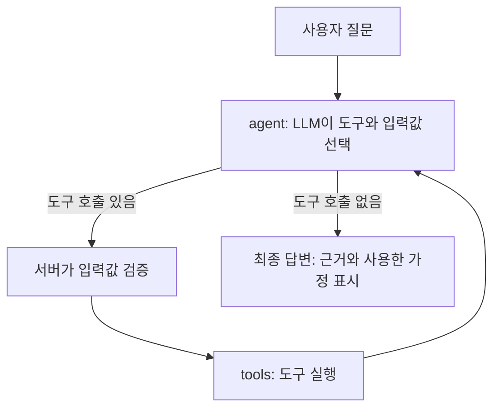
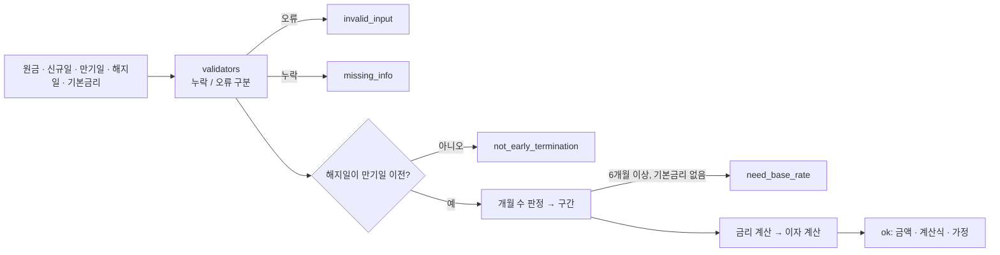
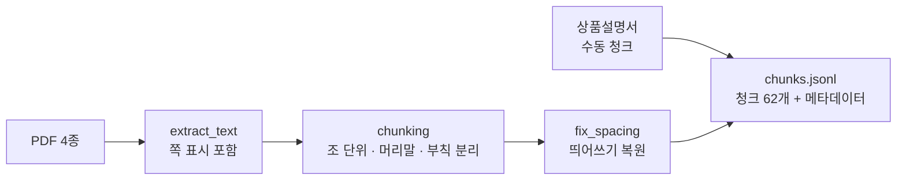
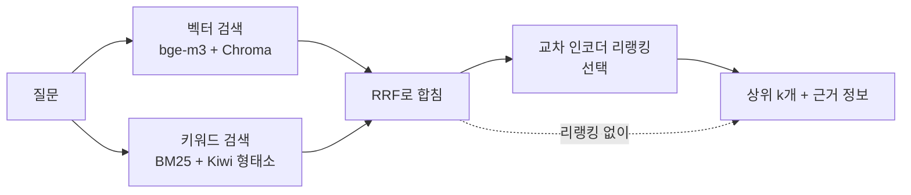

# banking-agent

로컬 LLM이 **약관 검색 · 이자 계산 · 상담 요청 저장** 도구를 스스로 골라 쓰고, 정보가 부족하면 되묻는 금융 상담 에이전트 (LangGraph + Tool Calling).

> **상태: 진행 중 (12일 계획 중 5일차까지 완료, 6일차는 실제 모델 1차 확인 후 보강 중).** 구현이 끝난 항목만 체크(`[x]`)로 표시합니다. 지금까지 만든 것은 **약관 데이터 파이프라인, 검색(RAG), 이자 계산 도구, 검증용 화면, 도구를 LLM에 연결하는 Tool Calling 코드와 측정 도구, agent ⇄ tools 반복 그래프**입니다. 도구 선택은 실제 qwen2.5:7b로 측정했고(5일차 절), 반복 그래프도 실제 모델로 한 번 돌려 봤습니다. 그 대화에서 모델이 말하지 않은 기본금리를 지어내는 문제가 나와 **값 근거 대조**를 추가했고(6일차 절), 보강 뒤 실제 모델 재확인은 아직입니다.
> 학습용 프로젝트이며 실제 금융 상담이나 자문이 아닙니다. 실제 이자는 은행의 해지예상조회로 확인해야 합니다.

## 지금까지의 핵심 결과

| 항목 | 결과 |
| --- | --- |
| 데이터 | 하나은행 『하나의 정기예금』 문서 4종 → 조항 단위 청크 62개 (메타데이터: 심의번호 · 제정/개정일 · 적용일 · 조항 · 쪽) |
| 검색 품질 (정답 있는 30문항) | 벡터 검색 + 검색용 설명: 정답 청크가 상위 5개 안에 **30/30**, 1위 24/30 |
| 정확한 검색 모드 | 하이브리드 + 교차 인코더 리랭킹: 1위 **29/30**, MRR 0.967 (대신 검색 약 2.2초) |
| 이자 계산 도구 | 기준 사례 A~G 7개가 기대값과 **정확히 일치**, 입력 검사와 경계일 시험 포함. 계산 코드에 버그 15개를 일부러 넣어 시험이 모두 잡는지 확인 |
| Tool Calling (5일차) | 도구 2개를 qwen2.5:7b에 연결하고 확인용 질문 25개로 측정: 설명 문구에 따라 통과 **9/25 → 14/25 → 15/25** (short → detailed → examples). 남은 문제는 약관 질문에 검색을 안 하는 것, 말하지 않은 값을 지어내거나 말한 값을 빠뜨리는 것 |
| 에이전트 그래프 (6일차) | LangGraph agent ⇄ tools 반복, 세션별 대화 저장, 도구 호출 5회 · 대기 30초 제한, **값 근거 대조**(사용자가 말하지 않은 값은 계산 도구에 넘기지 않고 되묻기). 실제 모델 첫 대화에서 기본금리를 지어낸 사례를 잡아 보강, 보강 뒤 재확인은 아직 |
| 확인 화면 | FastAPI 화면: 청크 탐색 · 검색 설정 비교 · 33문항 일괄 확인 · 스트리밍 채팅(SSE) · 이자 계산 · 도구 호출 · 에이전트 |
| 시험 | 띄어쓰기 복원, 하이브리드 검색, 이자 계산 · 입력 검사, 도구 정의 · 실행 · 채점, 에이전트 그래프 (pytest 473개) |

자세한 측정 방법과 한계는 [검색](#검색) 절, [이자 계산 도구](#이자-계산-도구) 절, [알려진 한계](#알려진-한계)에 있습니다.

## 왜 만들었나

이전에 만든 은행 상담 챗봇(AI Hub 금융 상담 데이터의 질문·답변 쌍을 활용)은 비슷한 질문에는 답할 수 있지만, 실제 상품 문서를 근거로 답하거나 이자를 정확히 계산하는 구조는 아니었습니다. 이 프로젝트는 다음을 목표로 새로 만듭니다.

- 답변에 **근거**(상품명 · 심의번호 · 기준일 · 조항)를 함께 보여준다
- 계산은 LLM 암산이 아니라 **파이썬 함수**가 하고, 입력값은 서버가 검증한다
- 필요한 값이 없으면 추측하지 않고 **되묻는다**, 문서에 없으면 "확인되지 않음"으로 답한다
- 기존 챗봇과 같은 질문 30~50개로 비교해 **개선 정도를 수치로 기록**한다

### 내 역할

| 구분 | 내용 |
| --- | --- |
| 팀 프로젝트 (banking-chatbot-mvp) | FastAPI 서비스 구현, LangChain 처리 흐름 구현 담당 |
| 개인 재구현 (banking_chatbot) | 팀 프로젝트를 처음부터 혼자 재구현 (분류 모델 + 로컬 Qwen 7B 생성) |
| 이 레포 (banking-agent) | 혼자 설계 · 구현: 약관 데이터 파이프라인, 검색(하이브리드 · 리랭킹)과 비교 측정, 이자 계산 도구와 입력 검사, 검증 화면, 이후 Tool Calling · 되묻기 · 평가 |

## 목표 시나리오

| 질문 | 에이전트 동작 (목표) |
| --- | --- |
| 정기예금 중도해지하면 이율이 어떻게 돼요? | 약관 검색 → 중도해지 구간표를 근거와 함께 답변 |
| (경과 6개월 미만) 1000만 원, 신규 · 만기 · 해지일 알려줌 | 약관 검색 → 구간 판단 → 이자 계산 → 금액 + 계산식 + 근거 |
| (경과 6개월 이상) 같은 질문 | 기본금리를 되묻기 → 차등율 · 경과율 반영해 계산 |
| 상담원 연결해주세요 | 질문과 확인된 내용을 요약해 저장, 저장 성공 시에만 접수 안내 |
| 문서에 없는 내용 | "문서에서 확인되지 않음"으로 안내, 추측하지 않음 |

## 설계



- LLM은 **어떤 도구를 어떤 값으로 부를지** 정하고, 실행과 검증은 코드가 합니다.
- 도구 실행 결과를 LLM에 다시 전달해 추가 호출 / 되묻기 / 최종 답변 중 하나를 고르게 합니다.
- 안전장치: 최대 도구 호출 횟수, 도구 대기 시간, 입력값 검사, 실패 시 안내 메시지.

### 도구

| 도구 | 입력 | 출력 | 상태 |
| --- | --- | --- | --- |
| `search_terms` | 검색어 (상품명은 코드가 『하나의 정기예금』으로 고정) | 조항 텍스트 + 상품명 · 심의번호 · 기준일 · 청크 종류 · 조항 | **구현됨** (`rag/search.py`), 모델 연결 코드 완료 (`app/tool_calling.py`), 그래프에서 호출 (`app/graph.py`) |
| `calc_interest` | 원금, 신규일, 만기일, 해지일, 기본금리(경과 6개월 이상일 때만) | 세전 이자, 지급 예상액, 구간, 중도해지금리, 경과일수, 계산식, 사용한 가정, 상태 코드 | **구현됨** (`app/tools/interest.py`), 모델 연결 코드 완료 (`app/tool_calling.py`), 그래프에서 호출 (`app/graph.py`) |
| `request_handoff` | 사용자 질문, 확인된 내용 요약 | 접수 번호 또는 저장 실패 | 8일차 구현 예정 |

## 대상 상품과 계산 규칙

- 상품: 하나은행 『하나의 정기예금』
- 출처: 요약 상품설명서, 준법감시인 심의필 제2025-설명서-199호 (2025.08.22), 금리표 기준일 2025.09.01 (세전)

| 경과 기간 | 중도해지금리 (연) |
| --- | --- |
| 1개월 미만 | 0.10% |
| 1개월 이상 ~ 3개월 미만 | 0.15% |
| 3개월 이상 ~ 6개월 미만 | 0.20% |
| 6개월 이상 ~ 9개월 미만 | 기본금리 × 60% × 경과일수 / 계약일수 |
| 9개월 이상 ~ 11개월 미만 | 기본금리 × 70% × 경과일수 / 계약일수 |
| 11개월 이상 | 기본금리 × 90% × 경과일수 / 계약일수 |

- 6개월 이상 구간은 계산값이 연 0.20% 미만이면 0.20%를 적용하고, 경과일수는 계약일수를 초과할 수 없습니다.
- 중도해지금리는 소수점 셋째 자리까지 적용하고 넷째 자리에서 절사합니다 (예: 1.564721% → 1.564%).
- 이자는 신규일부터 해지일 **전일**까지의 일수로 계산하고 원 미만은 절사합니다.
- 기본금리는 신규일 당시 고시된 계약기간별 기본금리이며, 가입 시 앱에 표시된 적용금리와 다를 수 있습니다 (쿠폰 우대금리는 중도해지 시 미적용).

### 계산 예시 (pytest로 고정됨)

원금 10,000,000원, 신규일 2026-01-01, 이자 = 원금 × 금리 × 경과일수 / 365, 원 미만 절사 (365는 [가정](#근거가-확인되지-않은-가정)). 이 값들은 `app/tools/interest_cases.py` 한 파일에 있고, 시험과 확인 화면이 같이 씁니다.

| 케이스 | 만기일 | 해지일 | 기본금리 | 경과일수 | 구간 | 중도해지금리 | 세전 이자 |
| --- | --- | --- | --- | --- | --- | --- | --- |
| A | 2027-01-01 | 2026-01-21 | 불필요 | 20 | 1개월 미만 | 0.10% | 547원 |
| B | 2027-01-01 | 2026-03-02 | 불필요 | 60 | 1~3개월 | 0.15% | 2,465원 |
| C | 2027-01-01 | 2026-05-31 | 불필요 | 150 | 3~6개월 | 0.20% | 8,219원 |
| D | 2027-01-01 | 2026-07-20 | 3.50% | 200 | 6~9개월 (60%) | 1.150% | 63,013원 |
| E | 2028-01-01 | 2026-10-28 | 4.00% | 300 | 9~11개월 (70%) | 1.150% | 94,520원 |
| F | 2027-01-01 | 2026-12-07 | 3.50% | 340 | 11개월 이상 (90%) | 2.934% | 273,304원 |
| G | 2031-01-01 | 2026-07-20 | 2.00% | 200 | 6~9개월 (60%) | 계산값 0.131% → 최저 0.20% | 10,958원 |

## 이자 계산 도구

`calc_interest`(`app/tools/interest.py`)는 **날짜를 그대로 받아 일수와 금액을 코드가 계산**합니다. LLM이 일수를 세거나 암산하지 않습니다. 결과에는 금액과 함께 계산식, 사용한 가정, 주의 사항이 들어가서 답변에 그대로 보여줄 수 있습니다.



**상태 코드** (에이전트가 읽고 다음 행동을 고릅니다)

| status | 뜻 | 에이전트의 다음 행동 |
| --- | --- | --- |
| `ok` | 계산 완료 | 금액 · 계산식 · 사용한 가정을 답변에 표시 |
| `need_base_rate` | 경과 6개월 이상이라 기본금리 필요 | 신규일 당시 고시된 기본금리를 되묻기 |
| `missing_info` | 필요한 값이 없음 | 부족한 값만 되묻기 |
| `invalid_input` | 단위 · 범위가 틀림 | 값을 다시 확인해 달라고 요청 |
| `not_early_termination` | 해지일이 만기일 이후나 당일 | 계산하지 않고 안내 (만기 해지는 금리 숫자가 문서에 없음) |

**입력 검사** (`app/validators.py`): 코드가 먼저 확인해서, LLM이 틀린 값을 넘겨도 계산이 실행되지 않습니다.

- 원금: 원 단위 정수, 100만 원 이상 (상품의 최소 가입금액). 미만이면 `최소 가입금액은 100만원입니다.`를 안내하고 날짜 같은 다른 값은 되묻지 않습니다. `"1000만원"`은 거절하고 `10000000`처럼 쓰라고 안내
- 날짜: `YYYY-MM-DD`만 허용, 만기일은 신규일 + 1개월 이상 5년 이하, 해지일은 신규일 이후
- 기본금리: 0% 초과 20% 이하 (1% 미만이면 단위 확인 경고)
- **받지 못한 값(되물을 것)과 받았지만 틀린 값(확인 요청)을 나누고**, 문제를 한 번에 모아 알려줍니다

**설계 결정**

- **정확한 분수(`Fraction`)로 계산합니다.** 소수점 절사가 부동소수점 오차 때문에 1원 어긋나지 않게 하려는 것입니다. 이자는 반올림이 아니라 내림입니다(63,013.69원 → 63,013원).
- **개월 수 판정은 한 함수에 모았습니다** (`app/tools/dates.py`). 문서에 월말 신규일 규칙이 없어서 가정으로 정했고, 은행 확인으로 규칙이 바뀌면 이 함수와 관련 시험만 고칩니다.
- **결과에 사용한 가정을 함께 돌려줍니다** (365일 기준, 개월 판정 방식, 경과일수 정의, 세전 기준).

**시험** (`tests/test_interest.py`, `test_validators.py`, `test_calc_api.py`)

- 케이스 A~G 일곱 개, 금리 절사(1.564721 → 1.564), 최저 0.20% 적용, 입력 오류와 누락, 상태 코드별 흐름, JSON 변환, 부동소수점 오차 방지, 개월 경계일
- 시험이 쓸모 있는지 확인하려고 **계산 코드에 버그 15개를 일부러 하나씩 넣었고**(이자 반올림, 최저금리 제거, 365 → 360, 차등율 변경, 만기 당일 처리 등) 시험이 모두 실패하는 것을 확인했습니다.

## Tool Calling 연결 (5일차)

모델을 한 번 호출해서 **어떤 도구를 어떤 값으로 부르는지** 확인하는 단계입니다. 도구 결과를 모델에 다시 넘겨 추가 호출 / 되묻기 / 최종 답변을 고르는 반복은 6일차(LangGraph)에서 붙입니다.

```text
질문 + 오늘 날짜(시스템 프롬프트) + 도구 정의 2개 -> qwen2.5:7b 1회 호출 -> 도구 호출 확인 -> (선택) 도구 실행
```

| 결정 | 이유 |
| --- | --- |
| 도구 정의를 OpenAI 함수 형식 dict로 직접 작성 | pydantic의 Optional이 `anyOf`로 바뀌면 모델 · Ollama가 혼동할 수 있고, 모델이 보는 스키마를 그대로 확인할 수 있다 |
| 검색 도구는 `query`만 받고 상품명은 코드가 고정 | `search_terms`의 상품 필터는 [상품명, 공통]만 허용해서, 모델이 '정기예금'처럼 조금만 다르게 쓰면 상품 전용 문서가 오류 없이 빠진다 |
| `calc_interest`의 인자는 모두 선택 | 모르는 값은 비우고 부르면 도구가 `missing_info`로 알려준다. 모델이 값을 지어내지 않는지가 핵심 확인 항목 |
| 날짜는 `YYYY-MM-DD` 그대로, 오늘 날짜는 시스템 프롬프트로 | 일수 · 개월 계산은 코드가 한다 (3일차에 7B가 일수를 지어낸 문제) |
| 시스템 프롬프트는 고정하고 도구 설명 문구만 3종 비교 | short(한 줄) / detailed(사용 조건 · 형식 · 지어내지 말 것) / examples(detailed + 예시). examples의 예시는 확인용 질문과 겹치지 않게 시험으로 고정 |

**확인용 질문 25개** (`eval/tool_cases.py`, 오늘 = 2026-10-28로 고정): 약관 8 / 계산(값 충분) 8 / 값 부족 5 / 엣지(10만원) 1 / 도구 불필요 3. 값 부족 질문은 되물어도, 아는 값만 넣어 불러도 통과이고, 질문에 없는 값을 넣으면 실패입니다. '150일 됐어요' · '5개월 전'에서 날짜를 계산해 넣는 것도 지어낸 값으로 셉니다.

**채점** (`eval/tool_check.py`)은 계산 도구가 실제로 받아들이는 방식(`app/validators.py`)으로 값을 읽어 비교합니다 (`"10,000,000원"`과 `10000000`은 같은 값). 오류 종류는 도구 선택(`missing_call`, `extra_call`, `unknown_tool`, `invalid_call`, `empty_query`)과 인자(`extra_arg` = 지어냄, `missing_arg`, `wrong_<인자>`, `date_not_iso`, `unparsable_principal`)로 나눕니다.

**검색어 재측정**: 3일차의 정답 있는 30문항을 모델에 보내, 모델이 만든 검색어로 검색한 순위와 질문 그대로 검색한 순위를 비교합니다. 모델이 검색 도구를 부르지 않으면 실패로 셉니다.

**시험**: 가짜 모델로 도구 정의 · 실행 · 채점 · 측정 실행기 · API를 시험하고, 실제 `ChatOllama`가 Ollama 서버로 보내는 요청(도구 정의 · 메시지 · `temperature 0` · `num_ctx 8192`)을 가로채 확인했습니다. 채점 · 도구 실행 코드에 버그 20개를 하나씩 넣어 시험이 모두 잡는지도 확인했습니다 (처음 19/20, 놓친 1개는 시험을 보강해 탐지).

### 측정 결과

qwen2.5:7b(Ollama), `temperature 0`, 오늘 날짜를 2026-10-28로 고정, 질문 25개를 설명 문구마다 1회씩 돌렸습니다. 같은 조건에서 `detailed`를 18문항까지 두 번 돌렸을 때 결과가 같았습니다(재현됨). 한 번씩만 측정했고 문항이 적어서 `detailed`와 `examples`의 1문항 차이는 단정할 수 없습니다.

| 설명 문구 | 통과 | 도구 선택 | 인자 (도구 선택이 맞은 것 중) | 응답 중앙값 | 주요 오류 |
| --- | --- | --- | --- | --- | --- |
| short | 9/25 | 17/25 | 9/17 | 3.3초 | 지어낸 값 14건, 검색 안 함 8건 |
| detailed | 14/25 | 21/25 | 14/21 | 2.5초 | 지어낸 값 5건, 검색 안 함 4건, 빠뜨린 값 3건 |
| examples | 15/25 | 22/25 | 15/22 | 2.3초 | 빠뜨린 값 5건, 검색 안 함 3건, 지어낸 값 2건 |

그룹별 통과: 약관 `0/8 → 4/8 → 5/8`, 계산(값 충분) `4/8 → 4/8 → 3/8`, 값 부족 `2/5 → 3/5 → 3/5`, 엣지(10만원) `0/1 → 0/1 → 1/1`이고, 도구 불필요 3문항은 세 문구 모두 통과입니다.

**검색어 재측정** (`detailed`, 정답 있는 30문항, 상위 5개)

| 검색어 | 1위 | 3위 안 | 5위 안 | MRR |
| --- | --- | --- | --- | --- |
| 질문 그대로 | 24/30 | 28/30 | 30/30 | 0.874 |
| 모델이 만든 검색어 | 17/30 | 17/30 | 17/30 | 0.567 |

모델이 검색 도구를 부르지 않은 질문 13개를 실패로 세어서 낮아 보입니다. **검색한 17개는 모두 1위**였고, 질문 그대로 3~5위였던 3개는 1위로 좋아졌으며 나빠진 질문은 없었습니다. 모델이 고른 짧은 키워드 검색어(`중도해지 이율`)는 질문 그대로보다 나쁘지 않고, 문제는 검색을 하느냐 마느냐입니다.

### 분석

- **설명 문구의 효과는 큽니다.** `short` → `detailed`에서 통과 9 → 14, 지어낸 값 14건 → 5건, 검색 안 함 8건 → 4건이 됐습니다.
- **문구에 따라 실패 유형이 바뀝니다.** `short`는 말하지 않은 기본금리를 연 1.5%로 8번 '채웠고', `detailed` · `examples`는 질문에 적힌 만기일이나 기본금리를 '빠뜨렸습니다'(빠뜨린 값 0 → 3 → 5건). 설명의 '모르는 값은 비워 둔다'와, `examples`의 예시 호출에 기본금리가 없는 것이 영향을 준 것으로 보이지만, 문구를 바꿔 다시 측정해야 확인됩니다.
- **문구로 고쳐지지 않은 것이 세 가지 있습니다.** (1) 약관 질문에 검색을 안 하는 경우(`detailed` 4/8, 검색어 재측정 13/30): 모델이 도구 없이 자기 지식으로 답하므로 근거 없는 답이 됩니다. (2) `150일 됐어요` · `5개월 전`에서 신규일을 계산해 넣는 오류: 세 문구 모두에서 남았고 계산도 틀렸습니다(150일 전은 2026-05-31인데 05-10 · 05-14 · 05-08을 넣음). (3) `detailed`에서 말하지 않은 기본금리를 3.5로 넣은 3건은 설명의 예시값과 같아 베낀 것으로 보입니다.
- **빠뜨림과 지어냄의 위험이 다릅니다.** 빠뜨린 값은 도구가 `missing_info` · `need_base_rate`로 알려줘서 되묻게 되므로 안전하지만, 이미 말한 것을 또 묻게 됩니다. 지어낸 값은 조용히 틀린 결과가 됩니다. 경과 6개월 미만에서는 기본금리가 무시되어 금액에 영향이 없었지만, 6개월 이상인 질문에서 기본금리를 지어내면 `need_base_rate` 안전장치를 건너뛰고 틀린 금액이 나올 수 있습니다.
- **기본 설명 문구는 `detailed`로 유지합니다.** `examples`와 1문항 차이라 단정할 수 없고, 둘 다 `short`보다 확실히 낫습니다.

### 개선 후보 (우선순위 순)

1. **코드로 막기**: 계산 도구에 넘기기 전에 각 값이 사용자 발화(앞 대화 포함)에 실제로 있는지 대조하고, 없는 값은 비워서 도구가 되묻게 합니다. 문구로 못 고친 신규일 계산과 기본금리 지어내기를 한 번에 막습니다. (`1년 만기`처럼 말에서 계산되는 만기일, `3.5%였어요` 같은 단독 답변은 예외 처리가 필요)
2. **설명 문구 v2**: 인자 설명의 예시값을 없애고, '말한 값은 빠짐없이 넣고 말하지 않은 값만 비운다'로 바꾸고, 기본금리를 말한 예시 호출을 추가한 뒤 같은 25문항으로 재측정합니다.
3. **검색 생략 줄이기**: 상품 규칙 질문은 검색 후 답하라는 규칙을 넣거나, 도구 없이 끝나는 답이면 코드가 검색을 한 번 먼저 실행해 근거로 줍니다.
4. **모델 비교**: 같은 25문항을 `TOOL_MODEL` 환경변수로 다른 모델에 돌려 비교합니다.

## 에이전트 그래프 (6일차, 측정 전)

5일차의 '모델 1회 호출'을 **도구 결과를 모델에 다시 넘겨 추가 호출 / 되묻기 / 최종 답변 중 하나를 고르는 반복**으로 이었습니다 (`app/graph.py`, 상태는 `app/state.py`).

```text
START -> agent -> (도구 호출이 있으면) tools -> agent -> ... -> (없으면) END
                \-> (한 질문의 도구 호출이 한도를 넘으면) limit -> END
```

| 부분 | 하는 일 |
| --- | --- |
| `agent` | 시스템 프롬프트(5일차 규칙 + 도구 결과 처리 규칙 + 확인된 값) + 대화를 모델에 보내 다음 행동을 받는다 |
| `tools` | 모델이 고른 도구를 실행해 결과(JSON)를 돌려준다. 대기 30초 제한, 시간 초과나 `error`는 1회 재시도, 같은 질문에서 같은 호출을 반복하면 실행하지 않고 `duplicate`로 알린다 |
| `limit` | 한 질문에서 도구를 5번 넘게 부르려 하면 실행하지 않고 '상담원 연결' 안내로 멈춘다 |
| 체크포인터 | `session_id`별로 대화와 확인된 값을 저장해서, 되묻기에 대한 답을 이어 받는다 (메모리 저장: 서버를 다시 시작하면 사라짐) |

**상태(State)**: 질문마다 새로 시작하는 값(도구 호출 횟수, 모델 호출 횟수, 호출 기록, 중단 사유, 오류)과 세션 동안 유지되는 값(대화 전체, **확인된 값**)을 나눴습니다. 확인된 값은 '모델이 계산 도구에 넣었고 입력 검사를 통과한 값'(원금 · 신규일 · 만기일 · 해지일 · 기본금리)이고, 형식이 틀린 값(원금 `1000만원`)이나 범위를 벗어난 값은 저장하지 않습니다. 다음 질문에서 시스템 프롬프트에 한 줄로 요약해 보여줘서, 기본금리를 되물은 뒤 답해도 앞서 받은 값을 잊지 않게 합니다.

| 설계 결정 | 이유 |
| --- | --- |
| 시스템 프롬프트는 저장하지 않고 매 호출마다 새로 만든다 | 오늘 날짜와 확인된 값이 항상 최신이어야 한다 |
| 이전 질문의 도구 결과(약관 본문)는 300자로 줄여 모델에 보낸다 | 로컬 모델의 문맥 8192토큰 안에 여러 번의 대화가 들어가게. 저장된 대화는 그대로 둔다 |
| 모델 호출이 실패하면 그 질문에서 쌓인 메시지를 모두 지운다 | 답 없는 질문이 대화에 남아 다음 질문과 꼬이지 않게. 화면에는 오류만 보인다 |
| 도구 호출 한도와 반복 차단 | 7B 모델이 같은 도구를 계속 부르는 반복을 끊는다. 반복 호출도 한도에 센다 |
| 입력 오류(`invalid_input`, `missing_info`)는 재시도하지 않는다 | 다시 해도 결과가 같다. 재시도는 시간 초과와 `error`에만 쓴다 |

### 값 근거 대조: 말하지 않은 값은 계산 도구에 넘기지 않는다

**실제로 난 문제.** 첫 실제 대화에서 `1000만원을 2026-01-01에 넣었고 만기는 2027-01-01이에요. 2026-12-07에 해지하면 이자 얼마예요?`라고 물었더니, 기본금리를 말한 적이 없는데 모델이 `base_rate: 3.5`를 넣었습니다. 되물어야 할 질문(`need_base_rate`)이 그대로 계산되어 273,304원이 나왔고, 답변은 "신규일 당시 고시된 기본금리 3.5%를 기준으로"라고 지어낸 값을 사실처럼 말했습니다. 금액이 기준 사례 F와 같았던 것은 모델이 도구 설명의 예시값(`예: 3.5`)을 그대로 베꼈기 때문입니다. 5일차 측정에서 예고된 '지어낸 값이 `need_base_rate` 안전장치를 우회하는' 경로가 실제로 일어난 것입니다.

**해결** (`app/grounding.py`): 계산 도구를 부르기 전에 각 값이 사용자가 한 말(앞 질문 포함)에 실제로 있는지 대조하고, 없는 값은 빼서 도구가 `missing_info` · `need_base_rate`로 되묻게 합니다. 뺀 값은 도구 결과의 `dropped_args`와 호출 기록에 남고, 확인된 값에도 저장하지 않습니다.

| 값 | 근거로 인정하는 것 |
| --- | --- |
| 원금 | 같은 금액 표현 (`1000만원`, `천만 원`, `1천만원`, `10,000,000원`, `10000000`) |
| 신규일 · 만기일 · 해지일 | 같은 날짜 표현 (`2026-01-01`, `2026.1.1`, `2026년 1월 1일`). 연도 없는 `12월 7일`은 올해(또는 말한 날짜의 해)일 때만 |
| 해지일 | `오늘` · `지금` · `당장`이라고 말했으면 오늘 날짜 (`지금까지`는 제외) |
| 만기일 | 말한 신규일에 `N년 만기` · `N개월짜리` · `만기 N년`을 더한 날 |
| 기본금리 | 사용자 말에 있는 같은 숫자 (`3.5%`, `3.5퍼센트`, `기본금리는 3.5였어요`). 금액 · 날짜 · 기간(`2년`)의 숫자는 제외 |
| 앞에서 확인된 값 | 이미 근거가 확인된 값이므로 그대로 인정 |

**확인한 것**
- 확인용 질문 25개 중 계산 질문 14개의 기대 인자가 모두 근거를 찾습니다 (말한 값을 거짓으로 거절하는 경우 0).
- 5일차 측정에서 모델이 실제로 지어낸 값 9건과 이번 대화의 기본금리 3.5가 모두 걸러집니다 (`150일 됐어요` · `5개월 전`에서 계산한 신규일 포함).
- 그래프 연동: 지어낸 기본금리가 빠지고 되묻기 → 사용자가 기본금리를 답하면 계산(273,304원)으로 이어집니다. 확인 화면의 에이전트 탭에는 `말하지 않은 값 제외: 기본금리 3.5`가 표시됩니다.
- 대조 코드와 연결 코드에 버그 24개를 하나씩 넣어 시험이 모두 잡는지 확인했습니다 (처음 21/25: 놓친 3개는 시험을 보강했고 1개는 중복 코드라 삭제).

**한계**: 값이 '말해졌는지'만 보고 어느 칸의 값인지는 보지 않습니다 (신규일을 만기일 칸에 넣으면 도구의 입력 검사가 잡습니다). 한글 숫자(`이천만 원`)와 `내일` · `다음 달` 같은 상대 날짜는 근거로 인정하지 않고 되묻습니다. 말한 값을 가끔 거절하면 이미 말한 것을 또 묻게 되지만, 틀린 값으로 계산하는 것보다 안전한 쪽을 택했습니다. 위 5일차 측정표는 근거 대조를 거치기 전의 모델 단독 결과입니다 (`eval/tool_check.py`는 대조를 거치지 않습니다).

**아직 하지 않은 것**: 검색 결과로 경과 구간을 판단해 되묻기를 결정하는 연결과 근거 표시 형식(7일차), 상담 요청 저장과 오류 상황 11가지 재현(8일차), 스트리밍과 `/chat` 정리와 트레이싱(9일차). 도구 시간 초과로 멈춘 스레드는 강제로 끝낼 수 없어서 백그라운드에서 끝날 때까지 남고 결과만 버립니다.

```bash
python -m app.graph "1000만원 2026-01-01 신규 2027-01-01 만기, 2026-12-07 해지하면 이자는?"   # 한 질문
python -m app.graph --chat        # 한 세션으로 이어서 대화 (되묻기에 답하는 흐름 확인, /new 새 대화)
```

확인 화면의 **에이전트** 탭에서도 같은 흐름을 볼 수 있습니다. 질문마다 도구 호출 기록(이름, 값, status, 재시도 여부)과 확인된 값이 보입니다. 가짜 모델로 흐름 · 한도 · 시간 제한 · 재시도 · 세션 · 오류 처리를 시험했고, 실제 `ChatOllama`가 도구 결과를 받은 두 번째 요청(역할 순서 system → user → assistant(도구 호출) → tool)을 가로채 확인했습니다. 코드에 버그 30개를 하나씩 넣어 시험이 모두 잡는지도 확인했습니다 (처음 28/30, 놓친 2개는 시험을 보강해 30/30).

## 데이터와 청킹

하나은행 상품공시실에서 내려받은 문서 4종을 **구조 기반**으로 청킹했습니다. 고정 길이로 자르면 중도해지 표나 조항이 중간에서 끊겨, 근거(조항)를 보여주려면 조 단위가 필요하기 때문입니다.

| 문서 | 버전 정보 | 청킹 방식 | 청크 수 |
| --- | --- | --- | --- |
| 『하나의 정기예금』 요약 상품설명서 | 심의필 제2025-설명서-199호 (2025-08-22), 2025-09-01 현재 | 항목 단위로 손질 (`rag/manual/`) | 17 |
| 『하나의 정기예금』 특약 | 2021-12-03 제정, 심의필 제2021-약관-528호 (2021-11-22) | 조 단위 자동 | 10 |
| 거치식예금 약관 | 2016-06-07 개정, 심사필 2021-약관-122호 (2021-03-22) | 조 단위 자동 | 4 |
| 예금거래 기본약관 | 심의필 제2024-약관-153호 (2024-12-24), 부칙 11 기준 2025-02-26부터 적용 | 조 단위 자동 + 전문 + 부칙 | 31 |

합계 62개 청크입니다. 문서마다 기준일이 다르므로(2016~2025) 답변에는 문서별 기준일을 함께 보여줘야 합니다.

> 원문 PDF(`rag/raw/`), 추출 텍스트(`rag/extracted/`), 생성된 청크(`rag/chunks/`), 손으로 정리한 상품설명서 청크 파일(`rag/manual/hana_deposit_product_sheet.md`)에는 문서 본문이 들어 있어 git에 올리지 않습니다. 직접 실행하려면 PDF를 내려받고, 상품설명서 청크 파일은 `rag/manual/FORMAT.md`의 형식대로 만들어 주세요.



- **조 단위, 긴 조는 항 단위로**: 900자를 넘는 조만 ①②③ 항 단위로 나누고, 나뉜 청크에는 조 제목을 붙입니다.
- **중도해지는 한 청크**: 산출근거 문장, 구간표, 차등율 · 경과율 주석, 절사 규칙은 계산에 한꺼번에 필요해서 한 청크로 합쳤습니다. 상품설명서에 같은 표가 두 번 나오는 것도 하나로 정리했습니다.
- **청크 종류**(`chunk_type`)로 구분합니다: `중도해지`, `이자계산_일반`(약정금리 문장), `만기후금리`, `일부해지`, `재예치`, `약관_조`, `약관_전문`, `약관_부칙` 등. 중도해지 질문에서 일반 이자계산 문장이 근거로 잘못 쓰이는지 평가에서 따로 봅니다.
- **메타데이터**: 상품명, 문서 종류와 제목, 심의번호 · 심의일, 제정/개정일, 적용일(`effective_date`), 기준일, 조항, 쪽, 출처 파일, 수집일.
- **추출 잡음 정리**: 쪽마다 반복되는 머리글과 쪽번호 제거, 원문에 없는 글자(쪽 번호 혼입) 제거, 특수 공백 정리.
- **띄어쓰기 복원** (`rag/fix_spacing.py`): PDF 추출에서 붙거나 벌어진 띄어쓰기를 Kiwi로 고칩니다. 정상 단어가 쪼개지는 오류(`내점할` → `내 점할`, `사유해제시` → `사유해 제시`)를 막으려고 조사/어미 경계에서만 공백을 넣고, 글자 하나가 두 형태소로 합쳐진 곳(내=나+의, 해=하+어)과 보조용언 앞, 붙여 쓴 법령명은 건드리지 않습니다. 실제 약관 문단을 포함한 회귀 시험으로 고정했고, 변경 내역은 `rag/chunks/spacing_changes.txt`에 전/후로 남깁니다.
- **검색용 설명**(`hint`): 사용자가 쓰는 말(깨다, 중간에 해지)과 문서 용어(중도해지)를 잇기 위해 핵심 청크 4개에 붙인 설명입니다. 검색(임베딩 · 키워드 · 리랭킹)에만 쓰고, 근거로 보여주는 본문에는 넣지 않습니다.

## 검색



| 구성 | 구현 |
| --- | --- |
| 벡터 검색 | Ollama `bge-m3`(1024차원) 임베딩, Chroma 코사인 거리. 임베딩 문장은 문서명 · 조항 · hint를 본문 앞에 붙여 만듭니다 |
| 키워드 검색 | 직접 구현한 BM25 (`rag/bm25.py`). Kiwi로 형태소를 쪼개 "중도해지하면"이 "중도해지금리"와 맞물리게 했습니다 |
| 합치기 | RRF (Reciprocal Rank Fusion, k=60). 단위가 다른 벡터 거리와 BM25 점수를 순위로만 합칩니다 |
| 리랭킹 | `BAAI/bge-reranker-v2-m3-int8` (fastembed, ONNX, 다국어). 후보 10개를 (질문, 문서) 쌍으로 다시 채점하고, 리랭커에게도 hint를 보여줍니다 |
| 필터 | 상품(상품 전용 문서 + 공통 문서)과 청크 종류, 벡터와 키워드 양쪽에 적용 |
| 안전장치 | 벡터 거리가 0.6을 넘는 결과는 버리고 `not_found`로 답합니다. 기본 검색 개수는 5개 |

### 비교 측정

33문항(튜닝용 22 + 새 표현 검증용 11) 중 정답이 있는 30문항으로, 같은 질문에 설정만 바꿔 측정했습니다. 정답은 근거 청크 하나(또는 허용 집합)로 엄격하게 잡았고, 결과는 `eval/runs/*.json`에 저장돼 `rag/compare_runs.py`로 비교할 수 있습니다.

| 설정 | 1위 | 3위 안 | 5위 안 | MRR | 함정 | 검색 시간(중앙값) |
| --- | --- | --- | --- | --- | --- | --- |
| 벡터 + hint **(기본)** | 24/30 | 28/30 | **30/30** | 0.873 | 1 | 약 0.1초 |
| 키워드 (BM25) | 19/30 | 24/30 | 25/30 | 0.718 | 5 | - |
| 하이브리드 | 25/30 | 28/30 | 29/30 | 0.889 | 2 | - |
| 하이브리드 + 리랭커 (리랭커에 hint를 안 보여줌) | 22/30 | 27/30 | 27/30 | 0.806 | 3 | - |
| 하이브리드 + 리랭커 + hint 제공 **(정확한 모드)** | **29/30** | 29/30 | 29/30 | 0.967 | 1 | 약 2.2초 |
| 위 + 1차 순서와 리랭커 순서를 RRF로 합침 | 26/30 | 29/30 | 29/30 | 0.917 | 2 | 약 2.2초 |
| 위(hint 제공) + 리랭크 후보 20개 | 29/30 | **30/30** | **30/30** | **0.978** | **0** | 약 4.4초 |

"함정"은 중도해지 질문에서 약정금리 이자계산 문장(`이자계산_일반`)이 정답보다 앞선 질문 수입니다.

- **키워드 단독은 새 표현에 약합니다.** "해약", "인출", "깨면" 같은 낱말이 문서에 없어 어휘가 안 맞았고, "이율", "계산" 같은 흔한 말에 끌려 엉뚱한 조항이 나왔습니다.
- **하이브리드는 정확한 용어 질문(경과율 등)의 1위를 올렸지만** 새 표현에서는 5위 안 포함이 오히려 줄었습니다.
- **리랭커는 hint를 함께 보여줘야 효과가 있었습니다.** 안 보여주면 1차 검색이 hint로 얻은 이득을 되돌려 전체가 나빠졌습니다(1위 22/30). 보여주자 29/30이 됐습니다.
- **후보를 20개로 늘리면 정확도가 더 오르지만 시간이 후보 수에 비례합니다** (쌍당 약 0.22초).
- 리랭커는 "세후 이자는 얼마예요?" 같은 의미 연결 질문에서 기본약관 제9조 ⑤(원천징수 후 금액 규정)를 1~2위로 올렸습니다(벡터 단독에서는 상위 3개에 없었음). 이 질문은 정답 라벨이 없는 그룹이라 수치에는 잡히지 않습니다.
- 같은 조건으로 두 번 측정한 결과가 거리까지 완전히 같아서, 순위 차이는 실행마다의 흔들림이 아니라 청크나 설정 변경의 효과입니다.

**기본은 빠른 벡터 검색**이고, 화면에서 검색 방식과 리랭킹을 골라 정확한 모드를 쓸 수 있습니다. 에이전트는 상위 5개를 읽으므로 정확도 못지않게 "정답이 결과 안에 들어 있는지"가 중요하다고 보고 5위 안 포함률을 기준으로 삼았습니다.

## 확인 화면과 스트리밍 채팅

튜터 조언에 따라 FastAPI로 확인 화면을 만들어 청크와 검색 결과, 계산 결과를 눈으로 점검합니다. 외부 라이브러리 없이 HTML · CSS · JavaScript만 썼고, 에이전트가 생기면 같은 화면에 연결합니다.

| 탭 | 하는 일 |
| --- | --- |
| 검색 | 질문을 넣고 결과 카드를 확인 (순위 · 거리 · 출처 · 심의번호 · 기준일 · 벡터/키워드/RRF/리랭크 점수 · 단계별 시간). 33개 예시 질문 버튼 |
| 청크 | 62개 청크를 훑어보고 메타데이터와 본문 확인, 본문 · 조항 · id 검색과 문서 · 청크 종류 필터 |
| 일괄 확인 | 33개 질문을 한 번에 돌려 정답 순위 · 함정 · 거리 · 검색 시간을 표로 확인 |
| 채팅 | 검색 근거를 먼저 보내고, 로컬 LLM 답변을 글자 단위로 흘려보냄 (SSE) |
| 이자 계산 | 케이스 A~G 버튼으로 입력을 채우고 결과를 기대값과 비교, 상태별(계산 완료 · 기본금리 필요 · 입력 오류 등) 안내와 계산식 · 가정 확인 |

상단에서 **검색 방식**(벡터 / 키워드 / 하이브리드)과 **리랭킹**(없음 / 교차 인코더 / LLM)을 바꿀 수 있고, 검색 · 일괄 확인 · 채팅 탭이 같은 설정을 씁니다.

**스트리밍 채팅 (`POST /api/chat/stream`)** 은 `status → sources → token(여러 번) → done` 이벤트를 SSE로 보냅니다. 근거 카드가 먼저 나타나고, 거리 한도를 넘는 질문은 LLM을 부르지 않고 "약관에서 확인되지 않습니다"로 답합니다. `10만원 넣으면 이자 얼마야?`처럼 **최소 가입금액(100만원) 미만을 넣는다는 질문**도 모델을 거치지 않고 `최소 가입금액은 100만원입니다.`로 바로 답합니다 (`app/tools/amounts.py`가 질문에서 가입 금액만 골라내고, 근거 카드로 최소 가입금액 조항을 함께 보여줍니다).

> **현재 채팅은 임시 단계입니다.** 로컬 `qwen2.5:7b`로 시험해 보니 검색은 정확했지만 답변 생성은 불안정했습니다. 중도해지 질문에 일부해지 규칙을 섞어 사실과 다르게 답하거나, 금액을 물으면 질문에 없는 일수를 가정하고 계산식을 만들거나, 근거에 있는 내용(세후 이자 관련 원천징수 규정)을 놓친 사례가 있었습니다. 프롬프트 규칙을 보강해도 일부만 개선됐습니다. 그래서 **계산은 모델이 아니라 도구가, 규칙의 정확한 값은 근거 카드가** 전달하는 구조로 바꿉니다 (계산 도구는 4일차에 구현 완료, 채팅 연결은 5일차 이후).

## 설계 결정: 왜 텍스트 파이프라인인가

페이지를 이미지로 검색하는 멀티모달 RAG나 ColPali 대신 PDF를 텍스트로 추출해 청킹하는 방식을 택했습니다.

- 문서가 텍스트 층이 있는 PDF라 추출이 가능하고, 겪은 문제(표 글자 뒤섞임, 쪽 번호 혼입, 띄어쓰기)는 수작업 확인과 규칙으로 해결할 수 있었습니다.
- **조항 단위 근거**(제9조의2)와 심의번호 · 적용일 메타데이터가 필요한데, 페이지 단위 검색은 이를 맞추기 어렵습니다.
- 계산 도구에 넣을 **정확한 숫자**는 검증된 텍스트가 필요합니다.
- 청크를 눈으로 점검하고 hint · 필터 · 거리로 측정할 수 있어서 3일차의 문제들(오분할, 부칙 꼬리, 순위 흔들림)을 찾아 고칠 수 있었습니다.
- 병목은 파싱이 아니라 생성과 계산이었습니다. 이미지 방식은 이를 해결하지 못하고 답변용 VLM이 하나 더 필요합니다.
- 스캔본이나 표 · 그림이 많은 문서였다면 비전 기반 검색을 검토했을 것입니다.

## 진행 현황

**1주차: 기초 · 도구**
- [x] 1일차: 환경 세팅, Tool Calling 지원 확인, LangGraph 기초
- [x] 2일차: 약관 데이터 준비 (상품설명서 · 약관 수집, 청킹, 메타데이터)
- [x] 3일차: 약관 검색 도구 (임베딩 · 적재 · `search_terms`), 하이브리드 검색과 리랭킹 비교, 확인 화면, 스트리밍 채팅
- [x] 4일차: 중도해지 이자 계산 도구 (`calc_interest`, 입력 검사) + 단위 테스트, 확인 화면의 이자 계산 탭
- [x] 5일차: Tool Calling 연결, 도구 설명 문구별 선택 결과 비교 (측정 완료: short 9/25, detailed 14/25, examples 15/25)

**2주차: 그래프 · 서빙**
- [ ] 6일차: 그래프 조립, 대화 상태 저장 (코드 · 시험 완료, 실제 모델 1차 확인에서 나온 값 지어내기 문제를 근거 대조로 보강, 보강 뒤 재확인 전)
- [ ] 7일차: 핵심 시나리오 (약관 검색 결과로 되묻기와 계산 연결)
- [ ] 8일차: 상담 요청 저장, 오류 처리
- [ ] 9일차: FastAPI `/chat` 엔드포인트 정리, 트레이싱

**3주차: 평가 · 배포**
- [ ] 10일차: 평가셋 작성
- [ ] 11일차: 평가 실행, 실패 사례 분석과 개선
- [ ] 12일차: Docker, 문서화

## 1일차 검증 결과

- 환경: macOS(Apple Silicon), Python 3.14.6, Ollama `qwen2.5:7b`

**LangGraph 기초 (`scripts/day1_hello_graph.py`)**
`State`, 노드, 조건부 엣지로 같은 노드를 반복 실행하는 그래프를 실행했습니다. 3번 반복 후 종료했고(`count = 3`), 그래프 그림에서 `work → work`(반복)와 `work → END`(종료) 두 갈래가 확인됐습니다.

**Tool Calling 지원 확인 (`scripts/day1_tool_check.py`)**
`add(a, b)` 도구 1개를 연결해 두 질문을 시험했습니다.

| 질문 | 기대 | 결과 |
| --- | --- | --- |
| 1234 더하기 5678은 얼마야? | `add` 호출 | `add(a=1234, b=5678)` 호출 |
| 안녕, 자기소개 한 줄만 해줘. | 도구 호출 없음 | `tool_calls = []`, 일반 답변 |

도구 1개와 질문 2개로 한 쉬운 시험이므로, 도구 3개와 날짜가 섞인 한국어 질문에서의 정확도는 5일차와 평가 단계에서 측정합니다.

## 실행 방법

검증 환경은 macOS(Apple Silicon) + Python 3.14이고, 다른 환경은 확인하지 않았습니다. Chroma와 fastembed가 의존하는 `onnxruntime`은 Python 3.14에서 Apple Silicon macOS 14 이상용 설치 파일만 확인했습니다.

```bash
git clone <repo-url>          # 본인 레포 주소: git remote get-url origin
cd banking-agent
python3 -m venv .venv
source .venv/bin/activate      # macOS의 PowerShell: ./.venv/bin/Activate.ps1
                               # Windows PowerShell: .venv\Scripts\Activate.ps1
pip install -r requirements.txt

ollama pull qwen2.5:7b         # 답변 생성 모델 (Ollama 앱이 실행 중이어야 함)
ollama pull bge-m3             # 임베딩 모델
```

**1. 약관 청킹** (원문 PDF 4개를 `rag/raw/`에, 상품설명서 청크 파일을 `rag/manual/`에 넣은 뒤)

```bash
python rag/extract_text.py     # PDF -> rag/extracted/*.txt
python rag/build_chunks.py     # -> rag/chunks/chunks.jsonl, 점검 보고서 출력
python rag/inspect_chunks.py hana-deposit-terms   # 청크 확인 (chunk_id 일부로 검색)
```

**2. 적재와 확인 화면**

```bash
python rag/ingest.py           # 청크를 임베딩해 Chroma에 넣고 키워드(BM25) 인덱스도 만듦
python rag/rerank.py           # (선택) 리랭커 모델을 미리 내려받고 동작 확인, 처음 한 번 약 0.57GB
uvicorn app.api:app --reload   # 브라우저에서 http://127.0.0.1:8000
```

청크 탭은 `chunks.jsonl`만 있으면 바로 열리고, 검색 · 일괄 확인 · 채팅 탭은 `ingest.py`를 실행한 뒤에 동작합니다. **이자 계산 탭은 Ollama도 인덱스도 필요 없습니다** (계산은 코드만 씁니다).

**3. 검색 품질 측정과 비교**

```bash
python rag/check_search.py --mode hybrid --rerank cross --save eval/runs/hybrid_cross.json
python rag/compare_runs.py eval/runs/dense.json eval/runs/hybrid_cross.json
```

`--mode`는 `dense | bm25 | hybrid`, `--rerank`는 `none | cross | llm`입니다. `compare_runs.py`는 두 기록의 조건 차이, 1위 / 3위 안 / 5위 안 / MRR, 순위가 좋아지거나 나빠진 질문, 검색 시간을 보여줍니다.

**4. 도구 선택 측정 (5일차, Ollama 필요)**

```bash
python -m app.tool_calling "1000만원을 2026-01-01에 넣고 2027-01-01 만기, 2026-05-31 해지하면 이자는?"   # 한 질문 (--run: 도구까지 실행)
python eval/tool_check.py --variant short    --save eval/tool_runs/short.json
python eval/tool_check.py --variant detailed --save eval/tool_runs/detailed.json
python eval/tool_check.py --variant examples --save eval/tool_runs/examples.json
python eval/tool_check.py --compare eval/tool_runs/short.json eval/tool_runs/detailed.json eval/tool_runs/examples.json
python eval/tool_check.py --retrieval --variant detailed --save eval/tool_runs/query_detailed.json   # 검색어 재측정 (ingest 후)
```

보조 옵션: `--repeat 3`(같은 질문 반복, 흔들림 확인), `--only C1,C3`(일부 질문만). 확인 화면의 **도구 호출** 탭에서도 질문을 골라 모델의 선택과 채점 결과를 볼 수 있습니다.

**5. 에이전트 대화 확인 (6일차, Ollama 필요)**

```bash
python -m app.graph --chat        # 같은 대화로 이어서 질문 (예: 기본금리를 되묻는지, 답한 뒤 계산하는지)
uvicorn app.api:app --reload      # 확인 화면의 '에이전트' 탭
```

**6. 시험**

```bash
pip install pytest
pytest tests
```

띄어쓰기 복원(정상 표기가 바뀌지 않는지, 실제 약관 문단에서 단어가 쪼개지지 않는지), 하이브리드 검색(RRF, BM25, 필터, 거리 한도, 리랭킹 배선), 이자 계산(기준 사례 A~G, 금리 절사, 입력 검사, 상태 코드, 개월 경계)을 시험합니다. 임베딩은 가짜를 쓰므로 Ollama나 모델 내려받기가 필요 없습니다.

**7. 1일차 실습 스크립트**

```bash
python scripts/day1_hello_graph.py   # LLM 없이 실행됨
python scripts/day1_tool_check.py    # Tool Calling 확인
python scripts/day1_tool_loop.py     # agent ⇄ tools 반복 (선택)
```

## 레포 구조

```text
banking-agent/
├── scripts/                 # 1일차 실습 스크립트
├── app/
│   ├── api.py               # FastAPI 서버 (청크 · 검색 · 일괄 확인 · 채팅 · 이자 계산 · 도구 호출 · 에이전트 API)
│   ├── chat.py              # 스트리밍 채팅 (검색 -> 근거 전송 -> LLM 토큰 전송)
│   ├── tool_calling.py      # 5일차: 도구 정의(설명 문구 3종) · 모델 호출 · 도구 실행
│   ├── state.py             # 6일차: 그래프 상태, 확인된 값 고르기
│   ├── grounding.py         # 6일차: 계산 도구 인자가 사용자 발화에 있는 값인지 대조
│   ├── graph.py             # 6일차: agent ⇄ tools 그래프, 세션별 대화, 호출 제한 · 재시도
│   ├── validators.py        # 도구 입력값 검사 (단위 · 범위, 누락과 오류 구분)
│   ├── tools/
│   │   ├── interest.py      # calc_interest: 중도해지 이자 계산
│   │   ├── dates.py         # 날짜 계산 (개월 수 판정 등)
│   │   ├── amounts.py       # 질문 속 가입 금액 읽기 (10만원 → 100,000)
│   │   └── interest_cases.py # 기준 사례 A~G (시험과 화면이 함께 사용)
│   └── static/              # index.html, style.css, app.js (확인 화면)
├── rag/
│   ├── extract_text.py      # PDF -> 텍스트 (쪽 표시 포함)
│   ├── chunking.py          # 조 단위 청킹, 머리말 파싱, 임베딩 문장 만들기
│   ├── fix_spacing.py       # 띄어쓰기 복원
│   ├── build_chunks.py      # 문서 4종 -> chunks.jsonl + 점검 보고서
│   ├── inspect_chunks.py    # 청크 확인용
│   ├── vectorstore.py       # 임베딩(Ollama bge-m3)과 Chroma 접근
│   ├── ingest.py            # 청크 -> 임베딩 -> Chroma + BM25 인덱스
│   ├── bm25.py              # 키워드 검색 (Kiwi 형태소 + BM25)
│   ├── rerank.py            # 리랭킹 (교차 인코더 · LLM)
│   ├── search.py            # search_terms(): 벡터 / 키워드 / 하이브리드 + 리랭킹
│   ├── check_search.py      # 33개 질문으로 검색 점검, 실행 기록 저장
│   ├── compare_runs.py      # 두 실행 기록 비교
│   ├── manual/              # 상품설명서 청크 (파일은 git 제외, FORMAT.md만 포함)
│   ├── raw/                 # 원문 PDF (git 제외)
│   ├── extracted/           # 추출 텍스트 (git 제외)
│   ├── chunks/              # 생성물 (chunks.jsonl, spacing_changes.txt, git 제외)
│   ├── chroma_db/           # 벡터 · 키워드 인덱스 (git 제외)
│   └── models/              # 내려받은 리랭커 모델 (git 제외)
├── eval/
│   ├── runs/                # 검색 설정별 측정 기록 (질문 · 청크 id · 거리)
│   ├── tool_cases.py        # 도구 선택 확인용 질문 25개와 기대값
│   ├── tool_check.py        # 도구 선택 채점 · 설명 문구 비교 · 검색어 재측정
│   └── tool_runs/           # 도구 선택 측정 기록
├── tests/
│   ├── test_fix_spacing.py   # 띄어쓰기 복원 회귀 시험
│   ├── test_hybrid_search.py # 하이브리드 검색 · 리랭킹 시험
│   ├── test_interest.py      # 이자 계산 시험 (기준 사례 · 절사 · 상태 코드 · 개월 경계)
│   ├── test_validators.py    # 입력 검사 시험
│   ├── test_calc_api.py      # 이자 계산 API 시험
│   ├── test_amounts.py       # 질문 속 금액 읽기 시험
│   ├── test_chat_min_deposit.py # 최소 가입금액 안내(채팅) 시험
│   ├── test_tool_calling.py  # 도구 정의 · 모델 호출 · 도구 실행 시험
│   ├── test_tool_check.py    # 도구 선택 채점기 시험
│   ├── test_tool_api.py      # 도구 호출 API 시험
│   ├── test_state.py         # 확인된 값 고르기 시험
│   ├── test_grounding.py     # 값 근거 대조 시험 (거짓 거절 없음 · 지어낸 값 제거)
│   ├── test_graph.py         # 그래프 시험 (반복 · 세션 · 한도 · 시간 제한 · 모델 실패)
│   └── test_agent_api.py     # 에이전트 API 시험
├── requirements.txt
├── .gitignore
└── README.md

# 구현 예정
├── app/                     # graph.py, state.py, tools/handoff.py (상담 요청 저장)
├── eval/                    # questions.jsonl, run_eval.py (질문 · 정답 · 근거)
└── docker-compose.yml
```

## 근거가 확인되지 않은 가정

문서에서 확인하지 못한 부분은 가정으로 두고, 답변과 계산 결과에도 함께 표시하며 평가 단계에서 검증합니다.

- 이자 계산의 나누는 수 365일 (문서에 숫자가 없음)
- **"N개월" 판정**: 신규일에 n개월을 더한 날(해당 월에 그 날짜가 없으면 말일)이 해지일 이하인 가장 큰 n. 문서에는 "완전히 지나간 기간"이라는 정의만 있고 월말 신규일(29~31일) 규칙은 없어서, 만기일 계산과 같은 방식으로 정했습니다 (`app/tools/dates.py`)
- 경과일수 = 해지일 − 신규일, 계약일수 = 만기일 − 신규일
- 재예치 계좌는 최종 재예치일을 신규일로 본다
- **경계 처리** (명세에 없어서 정함): 만기일 당일 해지는 만기 해지로 보고 계산하지 않음, 신규일 당일 해지는 이자 0원으로 계산하고 경고

## 범위 밖 (v1)

- 일부해지, 만기 후 해지 금액(기준 고시금리 숫자가 문서에 없음): 근거만 안내합니다.
- 세후 이자: 세율 숫자가 문서에 없어 계산하지 않습니다. 다만 기본약관 제9조 ⑤(실제 받는 이자는 원천징수한 세액을 뺀 금액)와 상품설명서의 비과세종합저축 가능 여부는 근거로 안내합니다.

## 평가 계획

- 질문 30~50개: 약관 질문 / 계산 질문 / 검색 + 계산 질문 / 정보가 부족한 질문 / 상담원 연결
- 질문마다 정답, 근거 조항, 필요한 도구를 미리 정해둡니다. 정답은 "반드시 필요한 청크"와 "관련 있는 청크"로 나눕니다.
- 기존 챗봇과 이번 에이전트에 같은 질문을 넣어 비교합니다
- 검색 품질(Recall@k)과 최종 답변(도구 선택 · 계산 정확도, 근거 없는 답변 비율, 응답 시간)을 따로 측정합니다
- 필수 시나리오: 6개월 미만 / 6개월 이상(기본금리 되묻기) / 쿠폰 적용금리를 기본금리로 말하는 경우 / 중도해지 질문에 약정금리 문장을 근거로 잘못 쓰는지 / 재예치 계좌 / 만기 이후 해지 / 일부해지 / 세후 이자
- 실패 사례는 원인 → 수정 → 재평가 순서로 수정 전후 수치를 기록합니다
- 지금까지의 검색 측정(33문항)은 평가 단계에서 **새로 만드는 평가셋과 LLM이 만든 검색어**로 다시 확인합니다

## 알려진 한계

- **평가 규모가 작습니다.** 33문항이고 1~3문항 차이는 단정할 수 없습니다. 검색용 설명(hint)은 튜닝용 22문항의 실패 사례를 보고 썼기 때문에 튜닝용 개선폭(3위 안 6/10 → 10/10)은 낙관적이며, 새 표현의 검증용 문항에서는 hint 효과가 확인되지 않았습니다.
- **정답 라벨이 엄격합니다.** 정답을 청크 하나로 잡아서 거치식약관 제3조처럼 관련 있는 일반 조항이 앞서면 실패로 집계됩니다.
- **거리 한도로는 같은 영역의 "문서에 없는 질문"을 거르지 못합니다.** 세후 이자(0.39) 같은 질문은 정답 질문과 거리가 겹쳐서, 무관한 질문(날씨, 0.69)만 걸러집니다. 나머지는 LLM이 "확인되지 않음"으로 판단해야 합니다.
- **7B 모델의 자유 서술 답변은 믿기 어렵습니다.** 계산과 규칙 전달을 도구와 근거 카드로 옮기는 이유입니다.
- **7B 모델의 도구 선택도 완전하지 않습니다.** 25문항 중 14~15개만 통과했고(5일차 측정), 약관 질문에 검색을 안 하거나 말하지 않은 값을 지어내는 경우가 남아 있습니다. 지어낸 값은 값 근거 대조가 막지만, 약관 질문에 검색을 안 하는 문제는 아직 그대로입니다.
- **리랭킹은 느립니다.** 후보 10개에 약 2초입니다. 그래서 기본값은 벡터 검색입니다.
- **최소 가입금액 안내는 `금액 + 넣다 · 예금하다 · 가입하다` 형태만 인식합니다.** `10만원을 1년 동안 넣으면`처럼 금액과 동사 사이에 말이 길게 끼면 놓치고 일반 경로로 갑니다. 잘못 잡느니 놓치는 쪽으로 만들었고(`이자 10만원 받으려면`은 가입금액으로 보지 않음), 한글 숫자(`이만원`)는 읽지 않습니다. 에이전트가 생기면 원금 추출은 LLM이, 검증과 안내 문구는 계산 도구가 맡습니다.
- **문서마다 기준일이 다릅니다.** 특약(2021), 거치식약관(2016 개정), 상품설명서(2025)의 내용이 다를 수 있어 답변에 문서별 기준일을 표시해야 합니다.
- **이자 계산의 가정은 은행 확인 전입니다.** 365일 기준, 개월 수 판정(월말 신규일), 경과일수 정의는 하나원큐 해지예상조회나 고객센터로 확인해야 하고, 결과에는 사용한 가정이 함께 표시됩니다.
