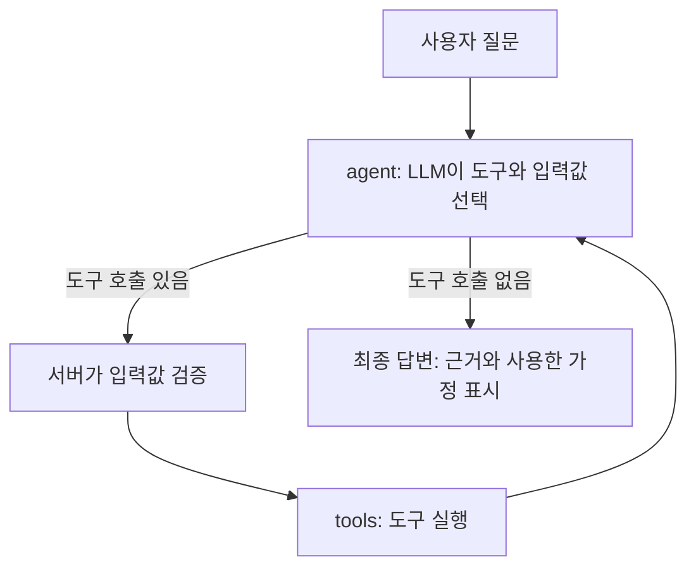

# banking-agent

로컬 LLM이 **약관 검색 · 이자 계산 · 상담 요청 저장** 도구를 스스로 골라 쓰고, 정보가 부족하면 되묻는 금융 상담 에이전트 (LangGraph + Tool Calling).

> **상태: 진행 중 (12일 계획 중 1일차 완료).** 구현이 끝난 항목만 체크(`[x]`)로 표시합니다.
> 학습용 프로젝트이며 실제 금융 상담이나 자문이 아닙니다.

## 왜 만들었나

이전에 만든 은행 상담 챗봇(AI Hub 금융 상담 데이터의 질문·답변 쌍을 활용)은 비슷한 질문에는 답할 수 있지만, 실제 상품 문서를 근거로 답하거나 이자를 정확히 계산하는 구조는 아니었습니다. 이 프로젝트는 다음을 목표로 새로 만듭니다.

- 답변에 **근거**(상품명 · 심의번호 · 기준일 · 조항)를 함께 보여준다
- 계산은 LLM 암산이 아니라 **파이썬 함수**가 하고, 입력값은 서버가 검증한다
- 필요한 값이 없으면 추측하지 않고 **되묻는다**, 문서에 없으면 "확인되지 않음"으로 답한다
- 기존 챗봇과 같은 질문 30~50개로 비교해 **개선 정도를 수치로 기록**한다

팀 프로젝트(banking-chatbot-mvp)에서는 FastAPI 서비스와 LangChain 처리 흐름을 담당했고, 이 레포는 그 한계를 해결하려고 처음부터 혼자 구현하는 개인 프로젝트입니다.

## 목표 시나리오

| 질문 | 에이전트 동작 (목표) |
| --- | --- |
| 정기예금 중도해지하면 이율이 어떻게 돼요? | 약관 검색 → 중도해지 구간표를 근거와 함께 답변 |
| (경과 6개월 미만) 1000만 원, 신규 · 만기 · 해지일 알려줌 | 약관 검색 → 구간 판단 → 이자 계산 → 금액 + 계산식 + 근거 |
| (경과 6개월 이상) 같은 질문 | 기본금리를 되묻기 → 차등율 · 경과율 반영해 계산 |
| 상담원 연결해주세요 | 질문과 확인된 내용을 요약해 저장, 저장 성공 시에만 접수 안내 |
| 문서에 없는 내용 | "문서에서 확인되지 않음"으로 안내, 추측하지 않음 |

## 설계



- LLM은 **어떤 도구를 어떤 값으로 부를지** 정하고, 실행과 검증은 코드가 합니다.
- 도구 실행 결과를 LLM에 다시 전달해 추가 호출 / 되묻기 / 최종 답변 중 하나를 고르게 합니다.
- 안전장치: 최대 도구 호출 횟수, 도구 대기 시간, 입력값 검사, 실패 시 안내 메시지.

### 도구 (구현 예정)

| 도구 | 입력 | 출력 |
| --- | --- | --- |
| `search_terms` | 검색어, 상품명 | 조항 텍스트 + 상품명 · 심의번호 · 기준일 · 청크 종류 · 조항 |
| `calc_interest` | 원금, 신규일, 만기일, 해지일, 기본금리(경과 6개월 이상일 때만) | 세전 이자, 적용 구간, 중도해지금리, 경과일수, 계산식, 사용한 가정 |
| `request_handoff` | 사용자 질문, 확인된 내용 요약 | 접수 번호 또는 저장 실패 |

## 대상 상품과 계산 규칙

- 상품: 하나은행 『하나의 정기예금』
- 출처: 요약 상품설명서, 준법감시인 심의필 제2025-설명서-199호 (2025.08.22), 금리표 기준일 2025.09.01 (세전)
- 원문 PDF는 `rag/raw/`에 두며 git에는 올리지 않습니다 (`.gitignore`).

| 경과 기간 | 중도해지금리 (연) |
| --- | --- |
| 1개월 미만 | 0.10% |
| 1개월 이상 ~ 3개월 미만 | 0.15% |
| 3개월 이상 ~ 6개월 미만 | 0.20% |
| 6개월 이상 ~ 9개월 미만 | 기본금리 × 60% × 경과일수 / 계약일수 |
| 9개월 이상 ~ 11개월 미만 | 기본금리 × 70% × 경과일수 / 계약일수 |
| 11개월 이상 | 기본금리 × 90% × 경과일수 / 계약일수 |

- 6개월 이상 구간은 계산값이 연 0.20% 미만이면 0.20%를 적용하고, 경과일수는 계약일수를 초과할 수 없습니다.
- 중도해지금리는 소수점 셋째 자리까지 적용하고 넷째 자리에서 절사합니다 (예: 1.564721% → 1.564%).
- 이자는 신규일부터 해지일 **전일**까지의 일수로 계산하고 원 미만은 절사합니다.
- 기본금리는 신규일 당시 고시된 계약기간별 기본금리이며, 가입 시 앱에 표시된 적용금리와 다를 수 있습니다 (쿠폰 우대금리는 중도해지 시 미적용).

## 데이터와 청킹

하나은행 상품공시실에서 내려받은 문서 4종을 **구조 기반**으로 청킹했습니다. 고정 길이로 자르면 중도해지 표나 조항이 중간에서 끊겨, 근거(조항)를 보여주려면 조 단위가 필요하기 때문입니다.

| 문서 | 버전 정보 | 청킹 방식 | 청크 수 |
| --- | --- | --- | --- |
| 『하나의 정기예금』 요약 상품설명서 | 심의필 제2025-설명서-199호 (2025-08-22), 2025-09-01 현재 | 항목 단위로 손질 (`rag/manual/`) | 17 |
| 『하나의 정기예금』 특약 | 2021-12-03 제정, 심의필 제2021-약관-528호 (2021-11-22) | 조 단위 자동 | 10 |
| 거치식예금 약관 | 2016-06-07 개정, 심사필 2021-약관-122호 (2021-03-22) | 조 단위 자동 | 4 |
| 예금거래 기본약관 | 심의필 제2024-약관-153호 (2024-12-24), 부칙 11 기준 2025-02-26부터 적용 | 조 단위 자동 + 전문 + 부칙 | 31 |

합계 62개 청크입니다. 원문 PDF(`rag/raw/`), 추출 텍스트(`rag/extracted/`), 생성된 청크(`rag/chunks/`), 손으로 정리한 상품설명서 청크 파일(`rag/manual/hana_deposit_product_sheet.md`)에는 문서 본문이 들어 있어 git에 올리지 않습니다. 직접 실행하려면 PDF를 내려받고, 상품설명서 청크 파일은 `rag/manual/FORMAT.md`의 형식대로 만들어 주세요.

- **조 단위, 긴 조는 항 단위로**: 900자를 넘는 조만 ①②③ 항 단위로 나누고, 나뉜 청크에는 조 제목을 붙입니다.
- **중도해지는 한 청크**: 산출근거 문장, 구간표, 차등율 · 경과율 주석, 절사 규칙은 계산에 한꺼번에 필요해서 한 청크로 합쳤습니다. 상품설명서에 같은 표가 두 번 나오는 것도 하나로 정리했습니다.
- **청크 종류**(`chunk_type`)로 구분합니다: `중도해지`, `이자계산_일반`(약정금리 문장), `만기후금리`, `일부해지`, `재예치`, `약관_조`, `약관_전문`, `약관_부칙` 등. 중도해지 질문에서 일반 이자계산 문장이 근거로 잘못 쓰이는지 평가 때 확인합니다.
- **메타데이터**: 상품명, 문서 종류와 제목, 심의번호 · 심의일, 제정/개정일, 적용일(`effective_date`), 기준일, 조항, 쪽, 출처 파일, 수집일.
- **추출 잡음 정리**: 쪽마다 반복되는 머리글과 쪽번호 제거, 원문에 없는 글자(쪽 번호 혼입) 제거, 특수 공백 정리.
- **띄어쓰기 복원** (`rag/fix_spacing.py`): PDF 추출에서 붙거나 벌어진 띄어쓰기를 Kiwi로 고치되, 복합어가 쪼개지지 않도록 조사/어미 경계에서만 공백을 넣고, 다른 분석이 그 자리를 한 단어로 보면 쪼개지 않습니다. 변경 내역은 `rag/chunks/spacing_changes.txt`에 전/후로 남깁니다. 원문 오탈자와 일부 붙은 글자는 그대로 남습니다.

## 진행 현황

**1주차: 기초 · 도구**
- [x] 1일차: 환경 세팅, Tool Calling 지원 확인, LangGraph 기초
- [x] 2일차: 약관 데이터 준비 (상품설명서 · 약관 수집, 청킹, 메타데이터)
- [ ] 3일차: 약관 검색 도구 (기본 RAG)
- [ ] 4일차: 중도해지 이자 계산 도구 + 단위 테스트
- [ ] 5일차: Tool Calling 연결, 도구 설명 문구별 선택 결과 비교

**2주차: 그래프 · 서빙**
- [ ] 6일차: 그래프 조립, 대화 상태 저장
- [ ] 7일차: 핵심 시나리오 (약관 검색 결과로 되묻기와 계산 연결)
- [ ] 8일차: 상담 요청 저장, 오류 처리
- [ ] 9일차: FastAPI, 트레이싱

**3주차: 평가 · 배포**
- [ ] 10일차: 평가셋 작성
- [ ] 11일차: 평가 실행, 실패 사례 분석과 개선
- [ ] 12일차: Docker, 문서화

## 1일차 검증 결과

- 환경: macOS, Python 3.14.6, Ollama `qwen2.5:7b`

**LangGraph 기초 (`scripts/day1_hello_graph.py`)**
`State`, 노드, 조건부 엣지로 같은 노드를 반복 실행하는 그래프를 실행했습니다. 3번 반복 후 종료했고(`count = 3`), 그래프 그림에서 `work → work`(반복)와 `work → END`(종료) 두 갈래가 확인됐습니다.

**Tool Calling 지원 확인 (`scripts/day1_tool_check.py`)**
`add(a, b)` 도구 1개를 연결해 두 질문을 시험했습니다.

| 질문 | 기대 | 결과 |
| --- | --- | --- |
| 1234 더하기 5678은 얼마야? | `add` 호출 | `add(a=1234, b=5678)` 호출 |
| 안녕, 자기소개 한 줄만 해줘. | 도구 호출 없음 | `tool_calls = []`, 일반 답변 |

도구 1개와 질문 2개로 한 쉬운 시험이므로, 도구 3개와 날짜가 섞인 한국어 질문에서의 정확도는 5일차와 평가 단계에서 측정합니다.

## 실행 방법

```bash
git clone <repo-url>
cd banking-agent
python3 -m venv .venv
source .venv/bin/activate      # macOS의 PowerShell: ./.venv/bin/Activate.ps1
                               # Windows PowerShell: .venv\Scripts\Activate.ps1
pip install -r requirements.txt

ollama pull qwen2.5:7b         # Ollama 앱이 실행 중이어야 함

python scripts/day1_hello_graph.py   # LLM 없이 실행됨
python scripts/day1_tool_check.py    # Tool Calling 확인
python scripts/day1_tool_loop.py     # agent ⇄ tools 반복 (선택)
```

약관 청킹 (원문 PDF 4개를 `rag/raw/`에 넣은 뒤):

```bash
python rag/extract_text.py     # PDF -> rag/extracted/*.txt
python rag/build_chunks.py     # -> rag/chunks/chunks.jsonl, 점검 보고서 출력
python rag/inspect_chunks.py hana-deposit-terms   # 청크 확인 (chunk_id 일부로 검색)
```

## 레포 구조

```text
banking-agent/
├── scripts/                 # 1일차 실습 스크립트
│   ├── day1_hello_graph.py
│   ├── day1_tool_check.py
│   └── day1_tool_loop.py
├── rag/
│   ├── extract_text.py      # PDF -> 텍스트 (쪽 표시 포함)
│   ├── chunking.py          # 조 단위 청킹, 머리말 파싱
│   ├── fix_spacing.py       # 띄어쓰기 복원
│   ├── build_chunks.py      # 문서 4종 -> chunks.jsonl + 점검 보고서
│   ├── inspect_chunks.py    # 청크 확인용
│   ├── manual/              # 상품설명서 청크 (파일은 git 제외, FORMAT.md만 포함)
│   ├── raw/                 # 원문 PDF (git 제외)
│   ├── extracted/           # 추출 텍스트 (git 제외)
│   └── chunks/              # 생성물 (chunks.jsonl, spacing_changes.txt, git 제외)
├── requirements.txt
├── .gitignore
└── README.md

# 구현 예정
├── app/                     # graph.py, state.py, validators.py, tools/, api.py
├── rag/ingest.py            # 3일차: 청크 -> 임베딩 -> Chroma
├── eval/                    # questions.jsonl, run_eval.py
├── tests/
└── docker-compose.yml
```

## 근거가 확인되지 않은 가정

문서에서 확인하지 못한 부분은 가정으로 두고, 답변에도 함께 표시하며 평가 단계에서 검증합니다.

- 이자 계산의 나누는 수 365일 (문서에 숫자가 없음)
- "N개월" 판정: 신규일 기준 달력상 완료된 개월 수 (경계일과 월말 신규일 규칙은 문서에 없음)
- 경과일수 = 해지일 − 신규일, 계약일수 = 만기일 − 신규일
- 재예치 계좌는 최종 재예치일을 신규일로 본다

## 범위 밖 (v1)

일부해지, 세후 이자(문서에 세율 근거 없음), 만기 후 해지 금액(기준 고시금리 숫자가 문서에 없음). 해당 질문은 근거만 안내하거나 "확인되지 않음"으로 답합니다.

## 평가 계획

- 질문 30~50개: 약관 질문 / 계산 질문 / 검색 + 계산 질문 / 정보가 부족한 질문 / 상담원 연결
- 질문마다 정답, 근거 조항, 필요한 도구를 미리 정해둡니다
- 기존 챗봇과 이번 에이전트에 같은 질문을 넣어 비교합니다
- 검색 품질(Recall@k)과 최종 답변(도구 선택 · 계산 정확도, 근거 없는 답변 비율, 응답 시간)을 따로 측정합니다
- 실패 사례는 원인 → 수정 → 재평가 순서로 수정 전후 수치를 기록합니다
