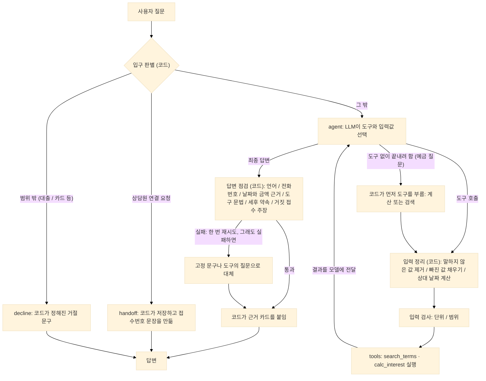

# banking-agent

로컬 LLM이 **약관 검색 · 이자 계산 · 상담 요청 저장** 도구를 스스로 골라 쓰고, 정보가 부족하면 되묻는 금융 상담 에이전트입니다 (LangGraph + Tool Calling, 로컬 qwen2.5:7b).
하나은행 『하나의 정기예금』 한 상품의 **중도해지 이자**를 약관 근거와 함께 안내합니다.

## 한눈에

| 항목 | 내용 |
| --- | --- |
| 하는 일 | 중도해지 이자 계산(근거 카드 / 계산식 / 가정 표시), 약관 질문 검색, 값이 부족하면 되묻기, 상담 요청 저장, 범위 밖 질문 거절 |
| 모델 · 데이터 | qwen2.5:7b(Ollama) / bge-m3 임베딩 / 약관 문서 4종을 조항 단위 청크 62개로 나눔 |
| 가장 중요한 결정 | **계산은 파이썬 함수가 하고**, 모델이 못 믿을 부분(값 추출, 도구 선택, 일부 문장)은 코드가 보정하거나 대신 쓴다 |
| 평가 | 문항 115개(개발용 84 / 검증용 31, 검증용은 고정하고 마일스톤당 한 번만 실행). 점수는 모델 없이 다시 계산할 수 있다 |
| 개발용 결과 (core 46) | 기대한 행동 **39/46**, 표시 없는 깨끗한 답변 **38/46** (사실 채점 포함) |
| 검증용 결과 (31) | 기대한 행동 **28/31**, 깨끗한 답변 **28/31** (Codex(AI) 작성 문항, 수정 후 한 번 더 실행) |
| 검색 품질 | 정답 청크가 상위 5개 안에 **36/36**: 검색은 병목이 아니고 실패는 7B 모델이 구간표를 읽는 단계에서 난다 |
| 도구 선택 | 코드 보정을 포함하면 45/46, **모델 혼자서는 26/46** |
| 시험 | pytest 1448개 (모델 · 색인 불필요), 시험 자체도 코드를 일부러 망가뜨려 잡는지 확인 |

## 문제 정의

이전에 만든 은행 상담 챗봇은 비슷한 질문에는 답했지만 **실제 상품 문서를 근거로 답하거나 이자를 정확히 계산하지 못했습니다.** 이 프로젝트의 목표는 다음입니다.

- 답변에 **근거**(상품명 / 심의번호 / 기준일 / 조항)를 함께 보여준다
- 계산은 LLM 암산이 아니라 **파이썬 함수**가 하고, 입력값은 코드가 검증한다
- 필요한 값이 없으면 추측하지 않고 **되묻고**, 문서에 없으면 `확인되지 않음`으로 답한다
- 같은 질문으로 **개선 정도를 수치로 기록**한다 (개발용과 검증용을 나눠서)

| 질문 | 동작 |
| --- | --- |
| 정기예금 중도해지하면 이율이 어떻게 돼요? | 약관 검색 → 중도해지 구간표를 근거와 함께 답변 |
| (경과 6개월 미만) 1000만 원, 신규 · 만기 · 해지일을 알려줌 | 이자 계산 → 세전 이자 + 계산식 + 근거 |
| (경과 6개월 이상) 같은 질문 | 기본금리를 되묻고, 받으면 차등율 · 경과율을 반영해 계산 |
| 지금 해지하면 이자 얼마예요? | 값이 없으니 부족한 값(원금 · 신규일 · 만기일)을 되묻는다 |
| 상담원 연결해주세요 | 질문과 확인된 내용을 저장하고, **저장에 성공했을 때만** 접수번호를 안내한다 |
| 대출 금리는 얼마예요? | 범위 밖이라고 거절한다 (코드가 정해진 문구로) |

## 처리 흐름



- 안전장치: 한 질문에서 도구 호출 최대 **5회**, 도구 한 번의 대기 **30초**, 모델 호출 한 번의 대기 **180초**와 출력 **2048토큰** 상한, 그래프 단계 수 한도.
- 코드가 먼저 부른 계산이 **값을 되물을 때는 모델을 다시 부르지 않고** 도구의 질문을 그대로 답합니다(모델이 되묻는 문장을 다시 쓰다 뜻을 뒤집은 사례 때문).
- 세션마다 대화를 이어 갑니다(예: 기본금리를 되묻고, 사용자가 답하면 앞서 받은 값으로 계산).

## 도구 목록

| 도구 | 입력 | 출력 | 상태 코드 |
| --- | --- | --- | --- |
| `search_terms` | 검색어 (상품은 코드가 『하나의 정기예금』으로 고정) | 조항 텍스트 + 상품명 / 심의번호 / 기준일 / 청크 종류 / 조항 / 쪽 | `ok` / `not_found`(거리 한도 0.6 초과) / `error` |
| `calc_interest` | 원금, 신규일, 만기일, 해지일, 기본금리(경과 6개월 이상일 때만) | 세전 이자, 지급 예상액, 구간, 중도해지금리, 경과일수, 계산식 | `ok` / `need_base_rate` / `missing_info` / `invalid_input` / `not_early_termination` · `error` |
| `request_handoff` | 사용자 질문, 확인된 내용 요약 (개인정보 칸 없음) | 접수번호 (SQLite `data/handoff.sqlite3`에 저장) | `saved` / `needs_confirmation` / `invalid_input` / `error` |


## 코드가 하는 일 / 모델이 하는 일

처음 설계는 `모델이 도구와 입력값을 고르고, 서버는 검사만 한다`였습니다. 로컬 7B 모델로 측정해 보니 **약관 질문에 검색을 생략하고, 말하지 않은 값을 지어내고, 없는 기능을 약속**했습니다. 그래서 같은 논리(계산을 도구로 분리한 것)를 입력값과 일부 도구 선택까지 넓혔습니다.

| 모델이 하는 일 | 코드가 하는 일 |
| --- | --- |
| 도구를 부를지, 어떤 도구를 부를지 (대부분의 질문) | 예금 질문인데 도구 없이 끝내려 하면 먼저 도구를 부름 |
| 질문에서 입력값 추출 | 모델이 넘긴 값을 사용자 말과 대조해 **말하지 않은 값은 삭제**, 빠진 값은 질문에서 읽어 채움, 한글 숫자(ex)2만원) / 상대 날짜 해석(ex)2달 뒤) |
| 약관 설명 / 계산 결과 설명 문장 | 이자 **계산**, 입력 검사, 답변 점검, 근거 카드 부착 |
| (모델이 직접 부른 경우) 값 되묻기 문장 | 코드가 부른 계산의 되묻기 문장, 상담 요청 저장, 접수 문장, 범위 밖 거절 문장 |


## 실행 방법

약관 원문 / 청크 / 색인은 **이 레포에 없습니다**(약관 본문을 올리지 않는 원칙, `.gitignore`). 약관 PDF 4개를 `rag/raw/`에 넣고, 상품설명서는 `rag/manual/`에 항목 단위로 정리한 파일(형식은 `rag/manual/FORMAT.md`)을 두어 청크와 색인을 직접 만들어야 합니다.

### 1. 로컬 (검증한 방법: macOS Apple Silicon + Python 3.14)

```bash
git clone <repo-url> && cd banking-agent
python3 -m venv .venv && source .venv/bin/activate     # macOS의 PowerShell: ./.venv/bin/Activate.ps1
pip install -r requirements.txt

ollama pull qwen2.5:7b          # 답변 생성 모델 (Ollama 앱이 켜져 있어야 함)
ollama pull bge-m3              # 임베딩 모델

python rag/extract_text.py      # rag/raw/의 PDF -> 텍스트
python rag/build_chunks.py      # -> rag/chunks/chunks.jsonl (+ 점검 보고서)
python rag/ingest.py            # 청크를 임베딩해 Chroma(rag/chroma_db)에 적재, 키워드(BM25) 인덱스도 만듦

uvicorn app.api:app --reload    # http://127.0.0.1:8000 (확인 화면)
python -m app.graph --chat      # 터미널에서 같은 대화로 이어서 질문
```

이자 계산 탭은 Ollama도 색인도 필요 없습니다(계산은 코드만 씁니다).

```bash
curl -s -X POST http://127.0.0.1:8000/chat -H 'Content-Type: application/json' \
  -d '{"question": "1000만원을 2026-01-01에 넣었고 만기는 2027-01-01이에요. 2026-12-07에 해지하면 이자 얼마예요? 기본금리는 3.5%였어요.", "session_id": "demo"}'
```

```powershell
Invoke-RestMethod -Method Post -Uri http://127.0.0.1:8000/chat -ContentType 'application/json' `
  -Body '{"question": "중도해지 이율이 어떻게 돼요?", "session_id": "demo"}'
```

응답에는 `answer`, `stop_reason`, 부른 도구 목록(`tools`), 근거 카드(`evidence`), 걸린 시간(`ms`)이 들어 있습니다. 질문은 `data/traces.sqlite3`에 기록되며(`TRACE_LOG=0`으로 끔), `python -m app.traces list --signals`로 도구를 잘못 고른 후보를 찾습니다.

### 2. Docker

청크 만들기(`extract_text.py` · `build_chunks.py`)는 컨테이너에서 지원하지 않습니다. **위 1번처럼 로컬에서 `rag/chunks/chunks.jsonl`을 먼저 만들어 두어야** 아래 `ingest`가 동작합니다.

```bash
# (가) 전부 컨테이너로: API + Ollama. 처음에는 모델(qwen2.5:7b, bge-m3)을 내려받느라 오래 걸립니다.
docker compose up --build
docker compose --profile build run --rm ingest          # 약관 청크를 색인에 넣기 (한 번, 청크를 바꿀 때마다)

# (나) 맥(Apple Silicon): 호스트의 Ollama(GPU 사용)를 쓰고 API만 컨테이너로
ollama pull qwen2.5:7b && ollama pull bge-m3
docker compose -f compose.host-ollama.yaml up --build
docker compose -f compose.host-ollama.yaml --profile build run --rm ingest
```

- **Chroma는 별도 컨테이너가 아닙니다.** API 프로세스 안에서 도는 `PersistentClient`라서 색인 폴더(`rag/chroma_db`)만 볼륨으로 연결합니다. 서버로 분리하려면 코드를 바꿔야 합니다.
- 볼륨: `./rag/chroma_db`(색인), `./data`(상담 요청 · 트레이스 DB), `./rag/chunks`(청크, 색인 적재 때만 읽기 전용). 약관 본문은 이미지에 들어가지 않습니다(`.dockerignore`).
- 포트는 `127.0.0.1:8000`에만 엽니다(로그인이 없는 서버라서). 로컬에서 `uvicorn`을 켜 둔 터미널이 있으면 `address already in use`로 막히니 먼저 끄세요.
- **`ingest`는 색인 폴더를 지우고 다시 만듭니다.** `./rag/chroma_db`는 로컬 색인과 **같은 폴더**를 연결한 것이라, 컨테이너에서 `ingest`를 돌리면 로컬 색인도 바뀝니다(중간에 실패하면 로컬에서 `python rag/ingest.py`로 다시 만듭니다). 이미 색인이 있으면 `ingest`는 필요 없습니다.
- 컨테이너의 Ollama는 **Apple Silicon의 GPU(Metal)를 쓰지 못해 CPU로 돕니다**: 맥에서는 (나)를 권합니다. NVIDIA GPU가 있으면 `compose.yaml`의 `deploy` 주석을 풉니다.
- qwen2.5:7b는 모델 파일만 약 4.7GB입니다. Docker Desktop은 기본 메모리가 작을 수 있으니 설정에서 올리세요.
- 리눅스에서 (나)를 쓰려면 Ollama를 `OLLAMA_HOST=0.0.0.0`으로 띄워야 컨테이너가 닿습니다.

### 3. 시험과 평가 재현

```bash
pip install pytest && pytest tests                         

python eval/run_eval.py --core --save eval/runs/eval_core_N.json     # 대표 문항 46개 (Ollama 필요, 약 10분)
python eval/run_eval.py --rescore eval/runs/eval_core_N.json         # 저장된 결과를 모델 없이 다시 채점
python eval/run_eval.py --retrieval --k 5                            # 검색 품질만 따로 (모델 없이, 색인 필요)
python eval/heldout_tools.py status                                  # 검증용 문항 고정 상태
```

## 모델 / 장비 / 응답 시간

| 항목 | 내용 |
| --- | --- |
| 답변 모델 | qwen2.5:7b (Ollama), `temperature 0`, 문맥 8192, 출력 상한 2048토큰, 호출 대기 180초 |
| 임베딩 / 검색 | bge-m3(Ollama) + Chroma 벡터 검색 기본. 하이브리드(BM25) + 교차 인코더 리랭킹은 선택(3일차 측정에서 1위 29/30, 대신 검색 약 2.2초) |
| 장비 | Apple M5 칩, 메모리 24GB, macOS, Python 3.14 |
| 실행 환경 | 호스트에서 돌린 Ollama. Docker(호스트 Ollama 방식)는 약관 질문 1건만 측정했고(22.3초), **컨테이너 안 Ollama(CPU)는 측정하지 않았습니다.** |

실제 모델로 측정한 응답 시간(위 장비에서 호스트의 Ollama로 질문 한 개를 처음부터 끝까지, 2026-11-02):

| 질문 유형 | 응답 시간 |
| --- | --- |
| 전체 (개발용 core 46) | 중앙값 7.4초, 90번째 백분위 21.8초 |
| 전체 (검증용 31) | 중앙값 10.1초, 90번째 백분위 28.9초 |
| 값 되묻기 | 약 6초 |
| 계산 완료 | 약 14초 (모델 호출 2회) |
| 약관 설명 | 개발용 중앙값 15.9초 / 검증용 24.3초 (가장 느림: 긴 답변을 생성) |
| 상담 요청 저장  범위 밖 거절 | 1초 미만 (코드가 직접 처리, 모델 호출 0회) |

## 평가

문항은 `eval/questions.jsonl`(개발용 84 · 검증용 31), 점수의 정의는 `eval/evaluate.py` 맨 위에 있습니다.

- **개발용**은 고치면서 보는 문항, **검증용**은 고치기 전에 따로 써서 **고정(문항별 sha256)하고  한 번만 실행**하는 문항입니다. 문항이나 정답을 보고 고치면 그 문항은 개발용이 되기 때문입니다(6일차 검증용 20문항이 그랬습니다).
- 정답은 기존 자료와 계산 도구에서 **파생**하고, 계산 정답은 도구 코드를 쓰지 않는 독립 공식으로 다시 검산합니다.

| | 기대한 행동 | 깨끗한 답변 | 도구(모델만) | 근거 없는 답변 표시 |
| --- | --- | --- | --- | --- |
| 개발용 core 46 (첫 실행) | 37/46 | 35/46 | 26/46 | 2/46 |
| 개발용 core 46 (수정 후, 사실 채점 포함) | **39/46** | **38/46** | 26/46 | 0/46 |
| 검증용 31 (첫 실행) | 28/31 (보정 채점기로 27/31) | 23/31 | 22/31 | 5/31 |
| 검증용 31 (수정 후) | **28/31** | **28/31** | 22/31 | 0/31 |

- **개발용 점수는 일반화 증거가 아닙니다.** 일부 문항은 실패를 보고 고쳤고(검색 문항 19개는 검색용 설명을 쓰는 데 참고), 개발용 수정 후 수치도 Q080 코드 거절을 반영한 **전체 재측정은 하지 않았습니다**(Q080만 확인).
- `도구(모델만)`이 수정 전후로 그대로인 것은, 수정이 모델의 도구 선택이 아니라 **코드의 보정과 점검**을 바꿨기 때문입니다.
- **검색 품질**(질문 그대로 검색, 정답 청크 30문항): 상위 5개 안 30/30, 1위 24/30, MRR 0.874. 3일차 기준선과 정확히 일치하고(회귀 없음), 전체 36문항도 5위 안 36/36입니다.
- 점수가 놓치는 것도 있었습니다: 규칙 질문의 답이 **틀려도** 행동과 근거 카드는 맞아서 통과했던 사례(Q023)를 읽다가 발견해 사실 채점을 더했습니다. 사실 채점은 규칙 core 14문항 중 6문항과 범위 밖 2문항에만 있어, 나머지 규칙 답변은 사람이 읽어야 합니다.(개발용 채점기에만 적용)

## 실패 사례와 해결

전체 목록과 원인 분류는 [실패 사례 분석](eval/failure_analysis.md)에 있습니다.

| 실패 | 원인 | 해결 | 상태 |
| --- | --- | --- | --- |
| 사용자가 말하지 않은 기본금리 3.5%를 넣어 계산하고 `고시된 기본금리 3.5%`라고 사실처럼 말함 | 7B가 빠진 값을 채움. 값은 도구 설명의 예시값(`예: 3.5`)을 그대로 베낀 것 | **값 근거 대조**: 모델이 넘긴 값이 사용자 말에 없으면 계산 도구에 넘기지 않고 되묻는다 | 해결 |
| 상담원 연결 요청에 지어낸 전화번호 / 연결해 준다는 약속, 중국어 섞임 | 7B가 없는 기능을 약속, 언어 지정 없음 | 상담 요청을 코드가 저장하고 문장도 코드가 씀 + **답변 점검**(언어 / 전화번호 / 날짜와 금액 근거 / 거짓 접수 주장) | 해결 |
| `사용자가 말하지 않은 값은 계산에 쓰지 않았습니다`를 사용자에게 읽어 줌 | 프롬프트의 문장을 모델이 따라 읽음 | 코드가 그 문장만 잘라 냄. 값이 부족한 질문 9개 중 4개(검증용)에서 모델이 이 문장을 사용자에게 읽어 줬는데, 이제 코드가 잘라 내서 사용자에게 보이는 건 0개 (나머지 5개 문장은 되묻기) | 해결 |
| `금리가 얼마예요?` / `세금이 붙나요?`를 금액 질문으로 보고 값을 되물음 | 코드의 계산형 판별이 너무 넓음 | 이자 **금액**을 묻는 말만 계산형으로 | 해결 |
| `대출 금리는 얼마예요?`에 예금 약관을 이어 붙여 엉뚱한 답 | 강제 검색이 맞지 않는 약관을 줌. 모델에게 거절을 맡겨도 질문을 오해함 | 범위 밖은 모델을 거치지 않고 코드가 거절 (1차 수정은 효과가 없어 2차로 바꿈) | 해결 |
| 점수는 통과인데 답이 틀림 (`두 달인데 3~6개월 구간`) | 점수가 행동과 근거 카드만 봄 | 사실 채점 추가(점수는 걸러내지만 **답은 못 고침**) | 7B 모델의 한계로 보여짐 |
| 만기까지 두 달 남았는데 지금 해지하면 이자 거의 못 받나?(검증용 X014)에서 답변을 드리지 못했어요가 나옴 (두 번 실행해도 같은 결과) | 모델이 질문에 없는 날짜를 지어내고, 남은 기간을 경과 기간으로 혼동함. 처음엔 되풀이 생성이라고 잘못 짐작했다가 진단으로 정정 | 답변 점검이 근거 없는 날짜를 잡아 틀린 답이 나가는 것은 막음. 값을 되묻게 하는 규칙을 실험했지만 약관 규칙을 묻는 비슷한 질문(Q027)까지 바뀌어 적용하지 않음 | **한계로 남김(답을 받지 않음)** |

## 한계

- **7B 모델이 구간표를 잘못 읽는 오류**(개발용 Q023, 검증용 X014)가 독립적으로 두 번 나왔습니다. 사실 채점이 잡기만 하고 고치지는 않았습니다.
- 남은 기간만 말한 질문(`만기까지 두 달 남았는데…`)은 가입일 없이 금액을 낼 수 없고, 지금은 모델이 날짜를 지어내 점검에 걸려 답이 없는 쪽으로 끝납니다.
- 모델이 규칙 질문에 계산 도구를 직접 부르는 경우(규칙 질문 25개 중 1), `1년 만기` 채움(Q054), `7월 말`(Q061), 재예치 신규일(Q063), `수수료` 키워드 오인(Q082).
- 코드가 보정하는 부분은 **낱말 · 정규식 규칙**이라 다른 표현에서 같은 실패가 날 수 있습니다.


## 검증 상태

| | 상태 |
| --- | --- |
| 로컬 실행 (macOS Apple Silicon, Python 3.14) | 실제 모델로 평가 / 대화 확인 |
| pytest 1448개 | 통과 (클린 클론에서 이전 변경분을 모두 얹어 확인) |
| Docker 설정 | **구문 / 경로 일치 / 약관 본문 제외 / 이미지 구성만으로 서버 기동**을 시험으로 확인 (`tests/test_docker_config.py`, 변형 시험 15개 모두 탐지) |
| 의존성 116개 | 리눅스 x86_64 / arm64에서 Python 3.14용 설치 파일이 **전부 있음을 조회로 확인** (115개는 미리 빌드된 파일, `kiwipiepy_model` 1개는 컴파일이 필요 없는 소스 배포본) |
| Docker 빌드 / 기동 (`compose.host-ollama.yaml`, macOS Apple Silicon = arm64) | **확인** (2026-11-02): 23단계 빌드 121초, 컨테이너 `healthy`, `/health` 200 |
| 컨테이너 → 호스트 Ollama / 색인 볼륨 / 데이터 볼륨 | **확인**: `/chat`이 약관 검색(색인 읽기)과 답변 생성(Ollama 2회)을 거쳐 근거 카드와 함께 응답, 대출 질문은 모델 호출 0회로 거절(16ms), 트레이스가 `./data` 볼륨의 DB에 로컬 기록 뒤로 이어서 기록됨 |
| 응답 시간 (Docker, 호스트 Ollama) | 약관 질문 1건 22.3초(검색 1.4초). **한 건이라 로컬 분포(약관 설명 중앙값 15.9초)와 비교할 수 없습니다** |


## 레포 구조

```text
app/            에이전트 본체
  api.py          FastAPI (/chat, /health, 확인 화면용 API)
  graph.py        LangGraph 그래프: 입구 판별 · agent ⇄ tools · 답변 점검 · 근거 카드
  tool_calling.py 도구 정의와 모델 연결, 호출 상한
  answer_check.py 답변 점검 (언어 · 전화번호 · 날짜와 금액 근거 · 도구 문법 · 내부 메모)
  grounding.py · slots.py · relative_dates.py · korean_numbers.py   입력값 정리 (대조 · 채움 · 날짜 · 한글 숫자)
  validators.py   입력 검사,  evidence.py  근거 카드와 계산형 질문 판별,  traces.py  요청 트레이스(SQLite)
  tools/          interest.py(이자 계산) · handoff.py(상담 요청 저장) · amounts.py · dates.py
  static/         확인 화면
rag/            약관 데이터 파이프라인과 검색
  extract_text.py → build_chunks.py → ingest.py   추출 → 청킹 → 적재 (Chroma + BM25)
  search.py · vectorstore.py · bm25.py · rerank.py   검색 (벡터 · 하이브리드 · 리랭킹)
  check_search.py · compare_runs.py                 검색 품질 측정과 비교
eval/           평가
  questions.jsonl   문항 115개 + build_questions.py (정답은 기존 자료에서 파생)
  evaluate.py · run_eval.py · heldout_tools.py       채점 · 실행 · 검증용 고정과 확인
  failure_analysis.md · wrong_tool_cases.md          실패 사례 분석, 도구를 잘못 고른 사례
tests/          pytest (모델 · 색인 불필요)
scripts/        1일차 실습 스크립트 (LangGraph 기본 · Tool Calling 확인)
docs/DEVLOG.md  일차별 개발 기록 전문
Dockerfile · compose.yaml · compose.host-ollama.yaml · .dockerignore
```

