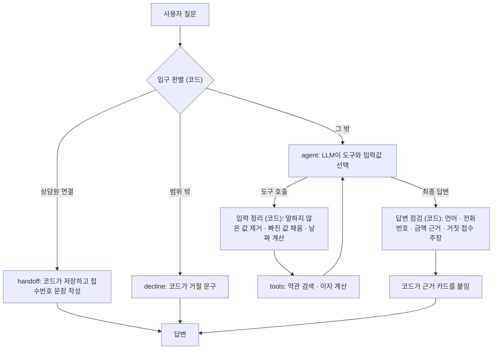

# banking-agent

『하나의 정기예금』 **중도해지 이자**를 약관 근거와 함께 안내하는 금융 상담 챗봇입니다. 이자 **계산은 코드**가 하고, **LLM은 질문을 이해하고 도구를 고르는 일**을 맡습니다 (LangGraph + Tool Calling, FastAPI).

> 학습용 프로젝트이며 실제 금융 상담이나 자문이 아닙니다. 실제 이자는 은행의 해지예상조회로 확인해야 합니다.
> 서비스: https://banking-agent.duckdns.org (접근 키가 필요합니다)

## 한눈에

| 항목 | 결과 |
| --- | --- |
| 개발용 평가 (46문항) | 기대한 행동 **41/46**, 표시 없는 깨끗한 답변 **40/46** |
| 검증용 평가 (31문항, 고정 후 한 번만 실행) | 기대한 행동 **28/31**, 깨끗한 답변 **28/31** |
| 검색 품질 | 정답 약관이 상위 5개 안에 **36/36**: 병목은 검색이 아니라 모델이 구간표를 읽는 단계 |
| 도구 선택 | 코드 보정 포함 45/46, **모델 혼자서는 27/46** |
| 응답 시간 (서버, API 모델) | 모델을 부른 질문 **중앙값 4.4초 · 90번째 백분위 7.7초**, 코드가 직접 답한 질문은 12ms 이하 |
| 프롬프트 인젝션 | 일곱 종류 확인, 시험이 찾은 틈 5곳 수정. 실제 모델 공격 19개 중 가드를 지나 통과한 것: 고친 뒤 0건 |
| 시험 | pytest **1998개** (모델 · 색인 불필요) + CI |

응답 시간은 서버 트레이스 78건 기준이고 제가 확인용으로 보낸 질문이 섞여 있습니다(2026-11-26~27, `python -m app.traces stats`로 직접 뽑음). 작은 표본이라 방문자 실사용 분포는 아닙니다. 평가 수치의 정의와 한계는 [상세 문서](docs/DETAILS.md#평가)에 있습니다.

## 무엇을 하나요

| 질문 | 동작 |
| --- | --- |
| 정기예금 중도해지하면 이율이 어떻게 돼요? | 약관 검색 → 구간표를 근거와 함께 답변 |
| 1000만 원, 신규 · 만기 · 해지일을 알려줌 | 이자 계산 → 세전 이자 + 계산식 + 근거 |
| 지금 해지하면 이자 얼마예요? | 값이 없으니 부족한 값을 되묻는다 |
| 상담원 연결해주세요 | 질문과 확인된 내용을 저장하고, **저장에 성공했을 때만** 접수번호를 안내 |
| 대출 금리는 얼마예요? | 범위 밖이라고 코드가 정해진 문구로 거절 |

화면은 메인, 상담 문의, 상담 이력, 이자 계산, 상담원 연결 5개 탭입니다. 답변 아래 "근거 약관"을 누르면 조항 본문이 열립니다.

## 구조



## 핵심 결정: 코드와 모델의 역할 나누기

처음에는 "모델이 도구와 값을 고르고 서버는 검사만 한다"로 설계했습니다. 로컬 7B 모델로 측정해 보니 약관 질문에 검색을 생략하고, 말하지 않은 값을 지어내고, 없는 기능을 약속했습니다. 그래서 측정으로 정한 만큼만 코드가 맡습니다.

| 모델이 하는 일 | 코드가 하는 일 |
| --- | --- |
| 도구를 부를지, 어떤 도구를 부를지 | 예금 질문인데 도구 없이 끝내려 하면 먼저 도구를 부름 |
| 질문에서 입력값 추출 | 사용자가 말하지 않은 값은 빼고, 빠진 값은 질문에서 읽어 채움 |
| 약관 · 계산 결과 설명 문장 | 이자 **계산**, 입력 검사, 답변 점검, 근거 카드, 상담 요청 저장과 접수 문장 |

## 이 프로젝트에서 보여 주려는 것

1. **모델을 믿지 않고 측정해서 역할을 나눴습니다.** 위 표가 그 결과입니다.
2. **평가를 의심했습니다.** 개발용과 검증용을 나누고, 점수는 모델 없이 다시 계산하며, 점수는 통과인데 답이 틀린 사례를 찾아 사실 채점을 더했습니다 ([실패 사례](docs/DETAILS.md#실패-사례와-해결)).
3. **방어를 시험으로 고정했습니다.** 가드마다 끄면 실패하는 시험이 있습니다 ([프롬프트 인젝션](docs/DETAILS.md#프롬프트-인젝션)).
4. **한계와 미확인을 숨기지 않았습니다.** 로컬 7B 모델은 서버(CPU)에서 한 질문에 4~5분이 걸려 서버만 API 모델로 바꿨습니다 ([검증 상태](docs/DETAILS.md#검증-상태), [한계](docs/DETAILS.md#한계)).

## 운영

- **배포**: Docker Compose + Caddy(HTTPS, 요청 속도 제한, 접근 키) → [배포 순서](docs/DEPLOY.md)
- **트레이스**: 서버에서는 같은 서버의 Langfuse로만 보내고 개인정보 모양은 가려서 저장합니다. 도구 선택 기록은 `python -m app.traces list --signals`
- **상담 기록**: 방문자 질문은 개인정보를 가려 서버에 30일 보관합니다. 운영자만 SSH로 봅니다 (`python -m app.history`)
- **상담원 요청**: 접수 기록은 30일 뒤 지우고, 방문자 화면의 내역은 브라우저에만 저장됩니다 (화면의 "기록 지우기"로 삭제)
- **비용 관리**: API 모델은 하루 호출 상한(서버 100건)을 넘으면 모델을 부르지 않습니다

## 실행

약관 원문 · 청크 · 색인은 이 레포에 없습니다(약관 본문을 올리지 않는 원칙). PDF를 `rag/raw/`에 넣고 직접 만들어야 합니다. 자세한 순서는 [상세 문서](docs/DETAILS.md#실행-방법)에 있습니다.

```bash
python3 -m venv .venv && source .venv/bin/activate && pip install -r requirements.txt
ollama pull qwen2.5:7b && ollama pull bge-m3
python rag/extract_text.py && python rag/build_chunks.py && python rag/ingest.py
uvicorn app.api:app --reload        # http://127.0.0.1:8000
```

```bash
pytest tests                         # 모델 · 색인 없이
python eval/ci_gate.py               # 모델 없는 평가 게이트 (CI에서도 실행)
```

이자 계산 탭은 Ollama도 색인도 필요 없습니다.

## 한계

- 7B 모델이 구간표를 잘못 읽는 오류가 두 번 나왔습니다. `가입한 지 N개월` 질문은 코드가 구간을 찾도록 고쳤지만, 남은 기간만 말한 질문(`만기까지 두 달 남았는데…`)은 그대로 남았습니다.
- 코드가 보정하는 부분은 낱말 · 정규식 규칙이라 다른 표현에서 같은 실패가 날 수 있습니다.
- 상품 하나, 세전 이자만 다룹니다. 공휴일은 감지하지 못하고 사용자 계정 없이 접근 키 하나를 나눠 씁니다.
- 검증용 31문항은 AI가 쓴 문항이라 일반화 증거로는 약합니다.
- 개인정보 가리기는 전화번호 · 이메일 · 계좌번호 같은 **모양**만 봅니다. 이름이나 주소 같은 서술형 정보는 가리지 못합니다.

## 다음에 보강할 것 (계획, 아직 하지 않음)

| 항목 | 이유 |
| --- | --- |
| 사람이 쓴 검증 문항 추가 | 지금은 AI가 쓴 문항뿐이라 일반화 근거가 약함 |
| 남은 기간 질문(X014형) 해결 | 한계에 남은 가장 분명한 실패 |
| 평가 결과를 자동으로 표로 내보내는 도구 | 지금은 수치를 손으로 옮겨 적음 (설계 초안을 만들었다가 접었음) |
| Langfuse 기록 자동 삭제 | 서버 트레이스는 30일 삭제가 없음 |
| 질문당 모델 비용 집계 | 지금은 호출 횟수와 시간만 보임 (Langfuse 토큰 기록을 활용할 수 있음) |
| 약관 개정 · 상품 추가를 다루는 갱신 절차 | 지금은 약관 4종을 한 번 적재하는 구조 |

## 더 읽을 것

- [상세 문서](docs/DETAILS.md): 계산 검증, 구간표 오독 수정 전후, 기존 챗봇과의 비교, MCP 서버, 모델 제공사, 검증 상태, 레포 구조
- [개발 기록](docs/DEVLOG.md): 일차별 상세
- [실패 사례 분석](eval/failure_analysis.md) · [도구를 잘못 고른 사례](eval/wrong_tool_cases.md)
